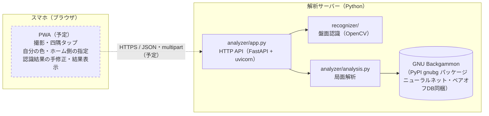
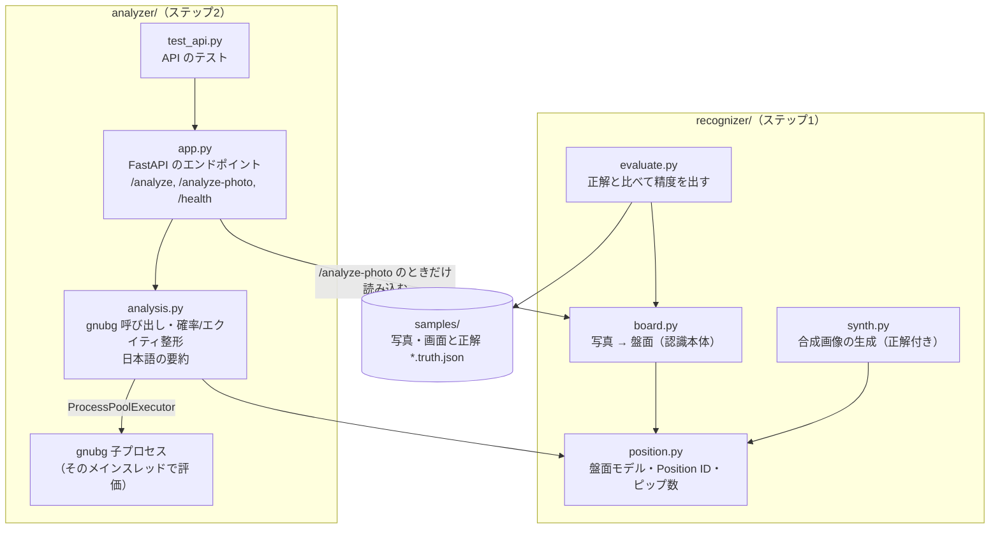
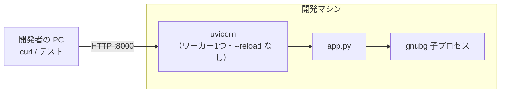
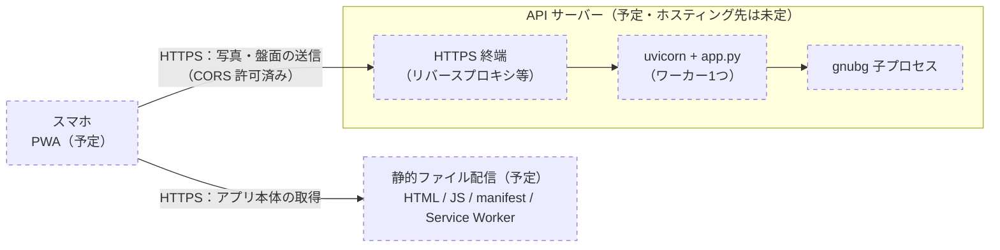

# bganalyzer

スマホで撮った実物のバックギャモン盤の写真から局面を読み取り、GNU Backgammon で解析する（勝率・ギャモン率・ピップ数）ためのプロジェクトです。最終的には PWA にする予定です。

図の中で点線・「予定」と書いた部分はまだ作っていません。

## 全体のソフトウェア構成

利用者のスマホで動く PWA（予定）が写真を撮り、サーバーの解析 API に送ります。サーバーは盤面認識（OpenCV）と局面解析（GNU Backgammon）を行い、結果を JSON で返します。

| 層 | 場所 | 技術 | 状態 |
|---|---|---|---|
| 画面（撮影・手修正・結果表示） | スマホのブラウザ | PWA | 予定（ステップ3） |
| HTTP API | サーバー | FastAPI / uvicorn | 済（ステップ2） |
| 盤面認識 | サーバー | Python / OpenCV | 済（ステップ1） |
| 局面解析 | サーバー（子プロセス） | GNU Backgammon（gnubg） | 済（ステップ2） |

## モジュール構成

| ファイル | 役割 |
|---|---|
| `recognizer/board.py` | 写真＋四隅 → 射影変換 → 三角形・縁で補正 → 駒を円として検出 → ポイントごとに数える。コマンドラインでも使える |
| `recognizer/position.py` | 盤面モデル（`points` 24個・バー・上がり）、gnubg Position ID の作成/読み込み、ピップ数。認識と解析の共通の型 |
| `recognizer/synth.py`, `evaluate.py` | 精度確認用（合成画像の生成、`samples/*.truth.json` との比較） |
| `analyzer/app.py` | HTTP API。JSON の盤面または写真を受け取り、認識・解析して返す |
| `analyzer/analysis.py` | gnubg で勝率・ギャモン率・エクイティ・最善手を計算。gnubg はメインスレッド以外で落ちるので専用の子プロセスで動かす |

詳しくは [recognizer/README.md](recognizer/README.md) と [analyzer/README.md](analyzer/README.md) を見てください。

## 処理の流れ（写真から解析まで）

## ネットワーク構成

### 今（開発中）

PWA はまだ無いので、API は `curl` などで直接呼び出します。

### 予定（公開後）

ホスティング先は未定です。gnubg が子プロセスとメインスレッドを必要とするため、サーバーレス関数ではなく常駐する Python プロセス（コンテナや VPS）で動かす想定です。

- 写真はサーバーに送って処理するだけで、保存はしません。
- API は CORS を全オリジン許可にしているので、PWA を別ドメインから配信しても呼び出せます。

## 現状

- `recognizer/`: ステップ1の盤面認識プロトタイプ（Python / OpenCV）。詳細は [recognizer/README.md](recognizer/README.md)。
- `analyzer/`: ステップ2の局面解析 API（GNU Backgammon / FastAPI）。詳細は [analyzer/README.md](analyzer/README.md)。
- `samples/`: 精度確認用の写真・アプリ画面と正解データ（`*.truth.json`）。

## 予定

1. 盤面認識の試作（済）
2. gnubg による解析（サーバー側）（済）
3. PWA（撮影・四隅指定・手修正）
4. 実写真での調整
