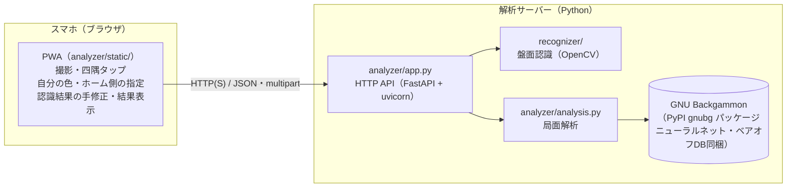
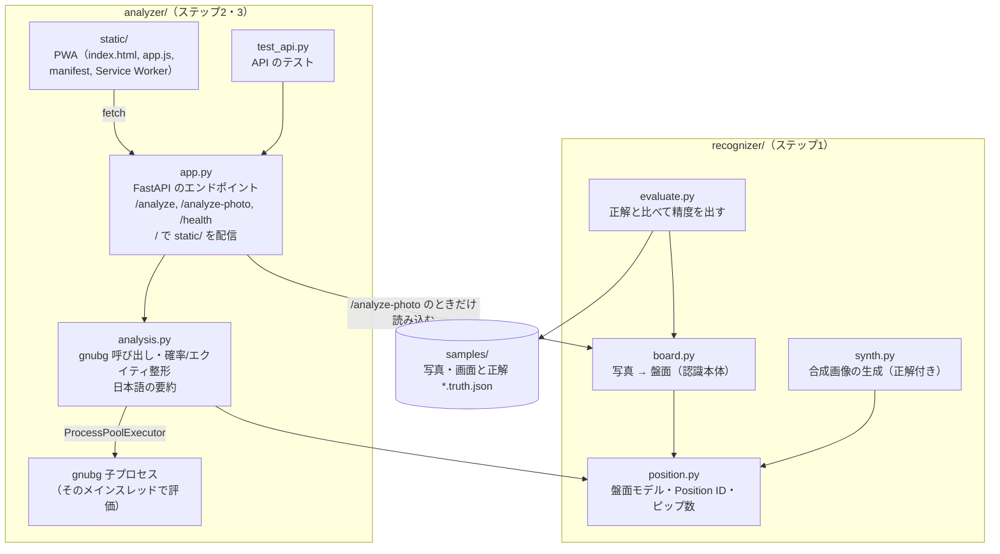
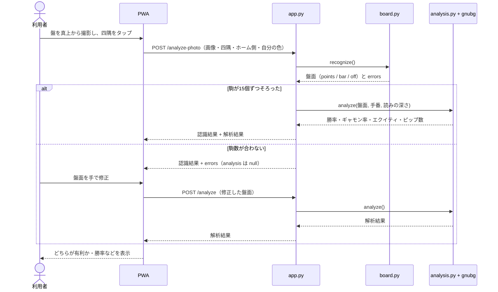
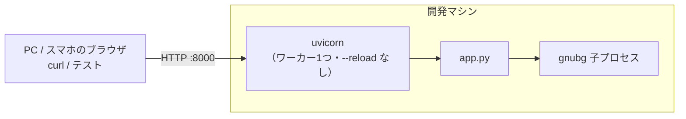
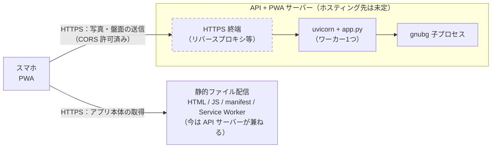

# bganalyzer

スマホで撮った実物のバックギャモン盤の写真から局面を読み取り、GNU Backgammon で解析する（勝率・ギャモン率・ピップ数）ためのプロジェクトです。スマホのブラウザで使う PWA から写真を送って解析できます。

図の中で点線・「予定」と書いた部分はまだ作っていません。

## 全体のソフトウェア構成

利用者のスマホで動く PWA が写真を撮り、サーバーの解析 API に送ります。PWA の画面（HTML / JS）も同じサーバーが配信します。サーバーは盤面認識（OpenCV）と局面解析（GNU Backgammon）を行い、結果を JSON で返します。



| 層 | 場所 | 技術 | 状態 |
|---|---|---|---|
| 画面（撮影・手修正・結果表示） | スマホのブラウザ | PWA（素の HTML / JS、ビルド不要） | 済（ステップ3） |
| HTTP API | サーバー | FastAPI / uvicorn | 済（ステップ2） |
| 盤面認識 | サーバー | Python / OpenCV | 済（ステップ1） |
| 局面解析 | サーバー（子プロセス） | GNU Backgammon（gnubg） | 済（ステップ2） |

## モジュール構成



| ファイル | 役割 |
|---|---|
| `recognizer/board.py` | 写真＋四隅 → 射影変換 → 三角形・縁で補正 → 駒を円として検出 → ポイントごとに数える。コマンドラインでも使える |
| `recognizer/position.py` | 盤面モデル（`points` 24個・バー・上がり）、gnubg Position ID の作成/読み込み、ピップ数。認識と解析の共通の型 |
| `recognizer/synth.py`, `evaluate.py` | 精度確認用（合成画像の生成、`samples/*.truth.json` との比較） |
| `analyzer/app.py` | HTTP API。JSON の盤面または写真を受け取り、認識・解析して返す |
| `analyzer/static/` | PWA。写真を選ぶ → 四隅をタップ（ルーペ付き・ドラッグで調整）→ `/analyze-photo` → 盤面を表示してタップで修正 → `/analyze` → 勝率・ギャモン率・ピップ・最善手を表示。長辺 2560px を超える写真は 2048px に縮めて送る |
| `analyzer/analysis.py` | gnubg で勝率・ギャモン率・エクイティ・最善手を計算。gnubg はメインスレッド以外で落ちるので専用の子プロセスで動かす |

詳しくは [recognizer/README.md](recognizer/README.md) と [analyzer/README.md](analyzer/README.md) を見てください。

## 処理の流れ（写真から解析まで）



## ネットワーク構成

### 今（開発中）

uv か Docker で起動し、PC やスマホ（同じ LAN）のブラウザで `http://<マシンのIP>:8000/` を開きます。
http のままでも写真の撮影・解析はできますが、ホーム画面への追加（インストール）とオフライン用の Service Worker は
HTTPS（または localhost）でしか有効になりません。

手元で動かすだけなら Docker は要りません。[uv](https://docs.astral.sh/uv/) で依存を入れて起動します
（`pyproject.toml` と `uv.lock` で版を固定）。

```bash
uv sync
uv run uvicorn app:app --app-dir analyzer --host 0.0.0.0 --port 8000
```

#### uv と Docker の役割

| | 管理するもの | 使う場面 |
|---|---|---|
| uv | Python のパッケージ（gnubg、FastAPI、OpenCV など）と Python 本体の版 | 手元での開発・テスト・起動。これだけで足りる |
| Docker | OS のライブラリ（gnubg が使う glib など）も含めた実行環境まるごと | サーバーに公開するとき、どのマシンでも同じ環境で動かすため（必須ではない） |

Docker イメージの中でも、Python のパッケージは同じ `uv.lock` から `uv sync --frozen` で入れています。

```bash
docker build -t bganalyzer .
docker run --rm -p 8000:8000 bganalyzer
```



### 予定（公開後）

ホスティング先は未定です。gnubg が子プロセスとメインスレッドを必要とするため、サーバーレス関数ではなく常駐する Python プロセス（コンテナや VPS）で動かす想定です。
リポジトリ直下の `Dockerfile` でそのままコンテナにできます。PWA は同じサーバーから配信するのが一番簡単ですが、
別の静的ホスティングに置く場合は `?api=https://APIのURL` を付けて開けば、その API を呼びます。



- 写真はサーバーに送って処理するだけで、保存はしません。
- API は CORS を全オリジン許可にしているので、PWA を別ドメインから配信しても呼び出せます。

## 現状

- `recognizer/`: ステップ1の盤面認識プロトタイプ（Python / OpenCV）。詳細は [recognizer/README.md](recognizer/README.md)。
- `analyzer/`: ステップ2の局面解析 API（GNU Backgammon / FastAPI）と、ステップ3の PWA（`analyzer/static/`、`/` で配信）。詳細は [analyzer/README.md](analyzer/README.md)。
- `Dockerfile`: API と PWA を1つのコンテナで動かす。
- `samples/`: 精度確認用の写真・アプリ画面と正解データ（`*.truth.json`）。
- `docs/HANDOVER.md`: 別アカウントの Claude プロジェクトと共同で開発するための手順と、今の状況。

## 予定

1. 盤面認識の試作（済）
2. gnubg による解析（サーバー側）（済）
3. PWA（撮影・四隅指定・手修正）（済）
4. 実写真での調整
