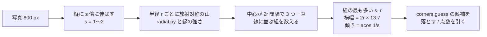

# TODO-071 の測定（駒を物差しにして四隅の候補を選ぶ）

写し直す前の写真（`corners.shrink` の 800 px）で駒を探し、その大きさから遊戯面の横幅を、楕円のつぶれ方から傾きを当てられるかを測った。
サンプルは synth-cube を除く 44 枚。

## やり方

- `measure_ruler.py`: TODO-068 は半径を「縁のはっきりした円の数」で選んで、駒の内側の輪・木目の小さい半径が勝った。
  今回は**中心の間隔**で選ぶ。積んだ駒は接しているので中心が直径の間隔で一直線に並び、内側の輪も中心は同じなので間隔は変わらない。
  半径 r ごとに、間隔 1.8r〜2.3r で 3 つが等間隔に一直線に並ぶ中心の数を数えた（縦向きの並び＝積み重ね、それ以外＝隣のポイント、を分けて）。
  斜めの写真用に、縦に 1.0・1.15・1.33・1.6・2.0 倍に伸ばした写真でも同じことをした。結果は `ruler.json`
- `analyse.py`: 伸ばし方と半径の選び方を変えて、横幅・傾きを正解（`*.truth.json` の四隅、`geometry.view_tilt_deg`）と比べる
- `simulate.py`: `check_corners.py --app` と同じ写真で `corners.guess` の最後の候補（`corners.DEBUG`）を取っておき（`candidates.json`）、
  駒から見た横幅で候補を落とす・点数を引くと、ずれ 3.6% 以内が何枚になるかを数える

## 結果

### 横幅

| 選び方 | 正解の ±10% | ±20% |
|---|---|---|
| 伸ばさない、全部の並び、約半分の半径に半分以上の組があればそちら | 26 / 44 | 32 / 44 |
| 伸ばさない、縦の並びだけ | 21 | 29 |
| 伸ばさない、横の並びだけ | 15 | 18 |
| 伸ばし方も選ぶ（縦の並び） | 10 | 15 |

外れは 2 倍（1 つおきの駒も等間隔に並ぶ）、0.4 倍前後（目や木目の並び）、斜めの写真（rollup-oblique 0.42、4b88u3 1.90、5wxq9t 2.38）。

### 傾き

縦に伸ばすほど山の数が増え、組の数も増えるので、伸ばし方で傾きは選べなかった。正解の ±10 度は 9 / 44（真上から撮った写真にも 50〜60 度と出る）。
**このやり方では傾きは分からない。**

### 四隅の候補を選ぶ

| 規則 | 3.6% 以内 | それより外れ | 見つからない |
|---|---|---|---|
| 今 | 28 | 14 | 2 |
| 横幅が駒の見当の 1.15 倍より外れた候補を落とす | 25 | 17 | 2 |
| 1.25 倍 | 26 | 16 | 2 |
| 1.4 倍・1.6 倍 | 28 | 14 | 2 |
| 点数から W × \|log(横幅 / 見当)\| を引く（W = 0.05・0.1） | 28 | 14 | 2 |
| 同（W = 0.2・0.4） | 27 | 15 | 2 |

良くなるサンプルは 1 枚も無かった。落とすと photo4（2.8% → 25.4%）、screen1（2.5% → 28.8%）、photo3 が悪くなる。

### なぜ効かないか: 今の外れは「大きすぎる」外れではない

候補の中で一番正解に近いものを選べれば 35 / 44 になる（今は 28）。外れている 16 枚の、今選ばれた候補の横幅 ÷ 正解の横幅:

| サンプル | 今のずれ | 選ばれた候補の横幅 | 候補の中で一番近いもの |
|---|---|---|---|
| diagram-prime・diagram-closed-bar | 4.7% | 1.00 | 1.5〜1.7%（横幅 1.00）。上の辺が 4.6% 上（枠の外の縁） |
| case-dice | 13.7% | 1.20 | 10.6%（1.16）。合う候補が無い |
| case-midgame | 7.7% | 0.89 | 5.3%（0.92） |
| 3wo2ot・bfqwve・h8ilqt・nardy-midgame・tavli-red-diamond | 4.3〜6.0% | 0.92〜1.04 | 2.2〜2.6%（0.95〜1.03） |
| set-cube-dice・lg-cube-dice | 3.8〜4.1% | 0.99〜1.00 | 同じかほぼ同じ |
| 4b88u3・tad9pt・rollup-oblique | 28〜41% | 0.63〜1.13 | 27〜40%。合う候補が無い |
| 5wxq9t・sj1vrx | 見つからない | | |

- TODO を立てたときに挙げた 4 枚のうち、横幅が大きすぎるのは case-dice だけ（1.20）で、その写真には合う候補がそもそも無い。
  prime・closed-bar は横幅が合っていて、上の辺だけが枠の外の縁にずれている
- 選び直せば直る 7 枚は、どれも選ばれた候補と一番近い候補の横幅の違いが 6% 以内。駒の物差しの精度（±10% に入るのが 26 / 44）では見分けられない
- 大きく外れる 3 枚と見つからない 2 枚は、候補を作る段階で合うものが出ていない（選び方では直らない）

### 時間

駒を探す処理は、伸ばさない場合だけでも 1 枚あたり手元の CPU で 10 秒前後（半径 24 通り × 3 チャンネル）。
今の四隅の検出は 0.44 秒で、Pi ではさらに数倍かかる。

## 2 回目: 候補ごとに写し直して測る（`measure_views.py`）

写真全体から駒の大きさを当てる代わりに、各候補の四角形を真上から見た画像（416 × 320）に写し直し、その中で駒を探した。
写し直すと傾きは消えるので、斜めの写真でも駒は円になる。測ったもの（`views.json` に書き出す。700 KB あるのでリポジトリには入れていない）:

- 縦の間隔: 積んだ駒が縦に等間隔で 3 つ並ぶ組の中心の間隔。高さ ÷ 間隔
- 横の間隔: 隣のポイントの駒が横に 3 つ並ぶ組の間隔。横幅 ÷ 間隔
- 丸さ: 積んだ駒の横の幅（その行の左右で一番強い縁の間）÷ 縦の間隔。候補が正しければ 1 で、大きさの見当が要らない

正解の四隅から写し直したときの値:

| | 求まったサンプル | 値の範囲 |
|---|---|---|
| 高さ ÷ 縦の間隔（の半分） | 41 / 44 | 3.3〜7.6（中央値 6.27。多くは 5.4〜7.0） |
| 横幅 ÷ 横の間隔（の半分） | 14 / 44（3 つ並んだ横の組が少ない） | 6.3〜7.3（中央値 6.60） |
| 丸さ | 41 / 44 | 0.75〜1.39（中央値 1.12） |

候補の点数から、中央値からの外れ（|log(値 / 中央値)|）× W を引いたとき:

| 規則 | W | 3.6% 以内 |
|---|---|---|
| 今 | | 28 |
| 高さと横幅 | 0.1・0.2 | 27（o32w4i 1.7% → 4.2%） |
| 高さと横幅 | 0.4・0.8 | 27・26（bfqwve は直るが、q0k95c 0.0% → 5.1% など） |
| 丸さ | 0.1 | 28（変わらない） |
| 丸さ | 0.2〜1.6 | 27〜24（photo4、o32w4i 1.7% → 14.0% など） |

- 写真ごとに見れば差は出ている。diagram-prime は正しい四隅で 5.52、選ばれた候補（上の辺が枠の外の縁）で 5.82〜6.04 と、高さが 7〜9% 大きく測れる
- ただし盤による違いのほうが大きい（高さ ÷ 間隔は盤ごとに ±13%、丸さは ±10% 以上ばらつく）。prime の正しい値 5.52 は中央値 6.27 より小さく、
  中央値に近い誤った候補のほうが勝ってしまう。丸さは、縁の取り違え（内側の輪、立体の縁）で正しい四隅でも 1 からずれる
- 時間は 1 枚あたり手元で 20 秒前後（候補 12〜24 個 × 半径 11 通り × 3 チャンネル）

ついでに分かったこと: `collected-s5dd7x.jpg` と `tv-vegas-open.jpg` は同じファイル（md5 が同じ）。`collected-h8ilqt` と `commons-tavli-red-diamond` も
四隅の候補と測った値が全部同じで、同じ写真の大きさ違いらしい。精度の数え方では 2 回数えている。

## まとめ

- 駒からの横幅の見当は ±10% に入るのが 26 / 44、傾きはこのやり方では当たらない
- 今の外れは横幅の大きすぎ・小さすぎではなく、1 辺のずれ（枠の内側と外側の縁）か、合う候補が無いことなので、駒の物差しでは直らない
- 候補ごとに写し直して測ると、同じ写真の中では正しい候補と外れた候補の差（高さで 7〜9%）が見えるが、盤ごとのばらつき（±10〜13%）のほうが大きく、
  決まった値と比べる形では選び直せない（2 回目）
- 選び直せば直る 7 枚（4〜6% → 2〜3%）と、prime・closed-bar の上の辺（枠の外の縁）は、物差しとは別の手掛かりが要る
