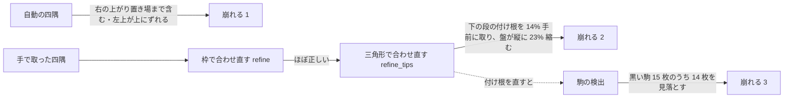

# TODO-076 の切り分け（main、2026-10-16）

写真: ユーザーの手元の `PXL_20240608_005725204.jpg`（4624×3472 に回したもの。対局者が左右に座り、white は左の人）。
PWA と同じく、写真を左に 90° 回して white を手前にしてから読んだ（`cv2.ROTATE_90_COUNTERCLOCKWISE`）。

正解（home right、`points[0]` がポイント 1）:
`[2,0,0,2,2,2,-2,2,0,2,0,-2, 2,0,0,0,0,-2,-5,-1,0,1,-3,0]`

## 1. 自動の四隅

`find_corners` は `[[1659.6,812.9],[3429.4,537.2],[3499.0,2537.1],[1475.4,2585.8]]`。
手で取った四隅（`[[1545,1055],[3100,495],[3115,2615],[1395,2580]]`）と比べると、右の辺が上がり置き場の外まで（x で 330〜380 px）出て、左上が 240 px 上にずれる。
この四隅から読むと white 13・black 11 枚で、どのポイントも合わない。

## 2. 三角形で合わせ直す段（今回の項目の中心）

手で取った四隅から読むと、枠で合わせ直すまではほぼ正しく、三角形で合わせ直したところで盤が縮む
（下の辺が y 2615 → 2227、上の辺が 1055 → 1274）。

原因は斜めの撮り方ではなく、**下の段の付け根（三角形が枠に届くところ）の取り方**:

- この盤の駒は 1 ポイントの幅より大きい（駒の直径 101 px、ポイントの幅 86 px。補正後の画像で）。
  下の段は 12 ポイントのうち 8 ポイントに駒が 2 枚ずつ載っていて、空いたポイントの付け根も隣の駒に隠れる
- `geometry._row_bases` は「外側の半分の中央値」を付け根とする。下の段で正しく取れた付け根は 2 つ（y 1003、995）だけで、
  残り 8 つは 837〜864。外側の半分（5 つ）の中央値が 864 になり、盤の高さを 1000 → 790 と見る
- 試しに「外側の 2 つの中央値」にすると、四隅は `[[1640.7,1076.5],[3161.1,418.0],[3167.4,2612.0],[1445.0,2582.8]]` で正しい位置に戻る
  （手で取った右の辺より 50 px 外。差が枠の縁の取り方だけかは未確認）

## 3. 駒の検出（盤の大きさとは別の問題）

付け根を直した版で読むと、white 15 枚はすべて合うが、black は 15 枚のうち 1 枚しか見つからない（黒い盤面の上の黒い駒）。
PWA の既定の「手前は明るい駒」（`bottom_colour=1`）で読んだ。

## 読み取りの比較（手で取った四隅、`bottom_colour=1`）

| 付け根の取り方 | 四隅 | 合う white | 合う black |
|---|---|---|---|
| 今（外側の半分） | 手 | 0 / 15 | 0 / 15 |
| 今（外側の半分） | 自動 | 0 / 15 | 0 / 15 |
| 外側の 2 つ | 手 | 15 / 15 | 1 / 15 |
| 外側の 2 つ | 自動 | 0 / 15 | 0 / 15 |

他のサンプルでは試していない。

## 正解の修正と、サンプルにしたあとの読み（2026-10-16）

ユーザーから正解をもらった。home は **left**（上の README の「正解」は左右を逆に取っていた）、サイコロは 6・2、キューブは真ん中の 64。
写真は盤の外を黒く塗って `samples/photo5.jpg` にした（人の手と腕が写っていたため。大きさは元のまま、EXIF なし）。

付け根を外側の 2 つで取った版で `evaluate.py samples/photo5.truth.json`: 19/24 ポイント。合わないのは black の 5 ポイントだけ。
home の推測も外れ（+7.0）、サイコロは読めない。`check_corners.py` では、盤の外を塗った写真だと自動の四隅が見つからない（塗る前は右と左上にずれた四隅を返した）。

## 黒い駒を見落とす理由（`why_dropped.py`）

`why_dropped.py` は `detect_checkers` の候補ごとに、測った値と落とされた条件を出す。

1. **候補にならない。** `radial.find` は一番強い山の 25%（`PEAK_REL`）より低い山を捨てる。真珠色の白い駒の縁が強く、黒い駒の縁は届かない。
   `RADIAL_TUNE=0.3,0.1`（10%）にすると 18 ポイントの 4 枚が出るが、ほかはまだ足りない（1・6・14・19 ポイントは 0 のまま）
2. **候補になっても落とされる。** 6 ポイント（x 463〜491）・14 ポイント（x 963）の候補は、駒の色が空いた盤面と同じ（`distinct` 0.5〜7）で、
   輪郭が全周に出ていない（`support` 0.33〜0.58 < `OUTLINE_SUPPORT` 0.8）。黒い盤面の上の黒い駒は、この条件に当たる

## 付け根の直し方（2026-10-16）

- **外側の 2 つの中央値**（ユーザーが最初に選んだ案）: photo5 は 19/24 になるが、ほかのサンプルで計 7 ポイント下がった（commons-tavli-blue 24 → 16 など）。やめた
- **反対の段の長さから取る**（`refine_tips`）: 片方の段の付け根までの長さが反対の段の 90%（`ROW_SHORT`。最初は 85% だったが、photo5 が 0.842〜0.847 と境目に近いと reviewer に言われて上げた）より短く、その段の付け根のうち外側の 2 つが反対の段の長さの 95%（`ROW_REACH`）まで届いているとき、
  反対の段の長さを使う。届いていないとき（collected-er0y2w の上の段は 10 か所ともそろって短い。届くのは 376 / 436 = 0.86）は、写真のとおり上下で長さが違うものとして変えない
- 試しは photo5・collected-er0y2w・commons-nardy-midgame（と、前の案で落ちた commons-tavli-blue・photo4）。基準の書き直しでは photo5 が 22 で足されたほかは、どのサンプルも変わらなかった（954/1056）

## 分担

測定と実装は、写真を見ながら試す作業で切り離しにくいので main が行った。差分のレビューは reviewer（`reviewer-report.md`）、3 枚の読みと分岐を外したときの読みの確認は verifier（`verifier-report.md`）。
