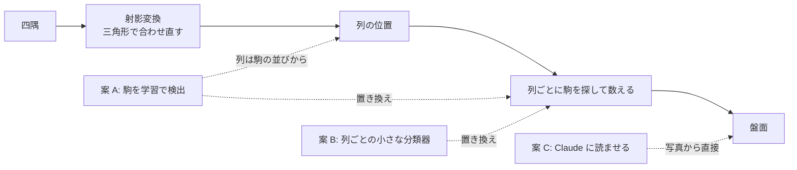

# TODO-081 駒・ポイントの読み取りの手法（main の調査報告）

2026-10-17。実装はしていない。測定は読み違いのある 4 枚だけ（全件は測らない）。reviewer の指摘（[reviewer-report.md](reviewer-report.md)）で 1.〜4. を直した。

## 1. `--slots`・`--section` を読み違いのある 4 枚で測った

recognizer 0.23.0、x86_64。生の出力は [eval-3-samples.txt](eval-3-samples.txt)。

| サンプル | 盤 | 円（今の読み方） | `--slots` | `--section` |
|---|---|---|---|---|
| collected-4b88u3 | 生成りの地・茶と黒の三角形、えんじと黒の駒（ユーザーの盤に近い） | 13 | 11 | 13 |
| collected-3wo2ot | 灰の地・赤と黒の三角形、赤と真珠色の駒 | 18 | 18 | 19 |
| collected-l9azfe | 緑の地・白と黒の三角形、黒と白い大理石の駒 | 18 | 20 | 16 |
| 上の 3 枚の合計（72 ポイント） | | **49** | **49** | **48** |
| photo5（[eval-photo5.txt](eval-photo5.txt)） | 黒い盤面に黒い駒（TODO-077） | 22 | 22 | 21 |

上の 3 枚の外れには、同じ色の上の駒を見落とすものが無かった（collected-4b88u3 の 5・24 は、山が隣の 6・23 に入る列のずれ）。
そのため、同じ色の上の駒の例として photo5 を足した。

**同じ色の上の駒で、円より当たるとは言えない。**

- photo5 の 1・6 ポイント（黒い盤面の黒い駒 2 個）を円は見落とす。slots・断面は 1 を当て、6 には駒があると読むが、数を 5・4 と多く読む。
  その代わり、円が当てている 19 を多く読み、断面は 18 を 1 つ少なく読む。合計は円と同じか悪い。
- 3 枚では、slots は collected-3wo2ot の 4・6（円は色を逆に読む）と collected-l9azfe の 3・6（円は 1 つ多く読む）・15 を当てるが、
  collected-3wo2ot の 2・3 と collected-l9azfe の 24 で色を逆に読み、collected-4b88u3 では 2 つ悪くなる。円と slots が両方外して断面だけが当てたポイントは無い。
- 3 つの読み方が揃って外す所が多い（下の 2.）。

## 2. 外し方の種類（3 枚から）

3 つの読み方が揃って外したのは 16 ポイント。

| 種類 | 例 | どの段階か |
|---|---|---|
| 山が 1 ポイント隣に入る | collected-4b88u3 の 6 ポイント（5 の −3 を 6 に、20 の +3 を 19 に、24 の −4 を 23 に）。写真は強く斜めで回っていて、駒は三角形からはみ出して置いてある | 列の位置（geometry、段階 5 の微調整） |
| 1 個だけの駒を見落とす・取り違える | collected-4b88u3 の 3・12・17、collected-3wo2ot の 10 | 未確認 |
| 盤の端の山をまるごと見落とす | collected-3wo2ot の 22〜24 | 未確認（列の位置か、駒の候補か） |
| 長い山を 1 つ多く数える | collected-l9azfe の 12・13・19（5 個を 6 個） | 山の数え方（駒の間隔） |

原因の切り分けはしていない（実害は未確認）。今の読み方は「ポイントの列を先に決め、その列の中で駒を数える」ので、
列が外れると数え方を変えても直らない。ただし列のずれと読めるのは 1 枚（collected-4b88u3）だけで、数え過ぎ（collected-l9azfe）は数え方の外れ。
三角形の無い盤は、列の位置と四隅の検出（`corners.py`、TODO-067）がどちらも三角形に頼るので、下のどの案でも四隅は別に要る。

## 3. 案

前提（TODO-067 と同じ）: 適当に撮った写真に使えること、Pi の CPU で動くこと、CPU による読みの違いは気にしない（TODO-074）。

### 案 A. 駒を学習した検出器で探し、駒の並びから列を決める

- 射影変換の後の盤（または写真）で、駒の外接矩形を小さな検出器（YOLO の n 型くらい）で出す。駒を x で山にまとめ、山を近いポイントに割り当てる。
- **効く所:** はみ出して置いた駒（collected-4b88u3）。三角形の無い盤でも、四隅が分かれば列は左右の半分を 6 等分した位置と駒の並びから決められる。色の差でなく形で拾うので、同じ色の上の駒にも効く見込み（未確認）。
- **Pi 5 の時間:** 検出器だけで、YOLO11n（640px）が NCNN で約 88 ms、ONNX Runtime で約 168 ms（Ultralytics の公表値、8.3.39）。`cv2.dnn` での時間は未確認。
  置き換わるのは駒を探す段階だけで、四隅・射影・三角形での合わせ直しは残る（今の読み取りは全体で 1 枚 10 秒。PI-035）。
- **依存:** 推論は今入っている OpenCV の `cv2.dnn`（ONNX を読める。5.0.0 で確認）で足りる見込み。NCNN や ONNX Runtime を使うなら依存が増える。学習は開発機で行い、Pi には重みだけ置く。
- **学習データ:** 今の `*.truth.json` はポイントごとの数だけで、駒の矩形が無い。今の円の検出の結果を正解の数に合わせて直したものを下書きにし、人が直す。`synth.py` の合成画像は矩形が自動で出せる。Roboflow Universe に駒に矩形を付けた公開データがある（ライセンスは要確認）。
- **注意:** Ultralytics の YOLO は AGPL-3.0。このリポジトリにはライセンスのファイルが無く、公開している。使うならライセンスを決めるか、AGPL でない検出器（自前の小さなモデルなど）にする。

### 案 B. ポイントの列ごとに、色と数を当てる小さな分類器（TODO-030 の「小さなモデル」）

- 射影変換の後の各ポイントの帯（幅 1 ポイント、長さ半分）を切り出し、(色, 数 0〜15) を当てる小さな CNN。バーは両方の色が載るので別に扱う。
- **効く所:** 長い山の数え過ぎ（collected-l9azfe）のような、列の中の数え方の外れ（未確認）。
- **学習データ:** 今の `*.truth.json` がそのまま使える（1 枚 24 本）。合成でない組は 53（盤面図 10 を含む。synth-cube の 12 は同じ写真の貼り込み）で、盤の種類ごとには少ない。TODO-030 で 50〜100 枚たまってから。
- **Pi 5 の時間:** 帯 24 本で数十 ms 以下の見込み（未測定）。
- **弱い所:** 列の位置は今の geometry のまま使うので、山が隣のポイントに入る外し方（collected-4b88u3）は直らない。三角形の無い盤は、案 A と同じく四隅が要る。

### 案 C. 写真を Claude に読ませる（`claude -p`、TODO-082 の仕組み）

- 四隅の「Claude に選ばせる」と同じく、利用者が押したときだけ写真を送り、盤面を JSON で返させる。
- **効く所:** 盤の種類に依らない。作るのは小さい（`analyzer/claude_corners.py` を下敷きにできる）。
- **弱い所:** 山の駒の数を数えるのが正確かは未確認。数秒〜数十秒かかり、写真を Anthropic に送る（CLAUDE.md の「変えないもの」に例外を 1 つ足すことになる）。
- 採るなら、まず 2〜3 枚で正解と比べてから決める。

### 採らない案

- `slots.py`・`section.py` を本番にする: 上の 1. のとおり当たりが増えない。全件でも円より悪かった（README の「位置ごとに判定する読み方の試作」「断面で数える読み方の試作」、TODO-050）。
- 駒を物差しにする: TODO-071 に分けてある。

## 4. まとめ

| 案 | 列のずれ（4b88u3） | 数え過ぎ（l9azfe） | 三角形の無い盤 | 時間（駒を探す段階） | 手間 |
|---|---|---|---|---|---|
| A 検出器 | 直る見込み | 直る見込み（駒を 1 つずつ拾う） | 四隅が分かれば | 約 0.1〜0.2 秒（公表値、`cv2.dnn` は未確認） | 大（矩形の正解づくり、ライセンス） |
| B 列ごとの分類器 | 直らない | 直る見込み | 四隅が分かれば | 未測定（小さい） | 中（写真がたまってから） |
| C Claude | 未確認 | 未確認 | 読める見込み（四隅も要らない） | 数秒〜 | 小（試すのは 2〜3 枚） |

外し方は 1 種類に偏っていない（3 枚では列のずれ・見落とし・数え過ぎが 1 枚ずつ）。列のずれまで扱えるのは A と C で、
B は数え方の外れだけに効く。どれも見込みで、採るなら別の項目で 2〜3 枚から試す。

## 5. 案 C を 3 枚で試した（2026-10-17、ユーザーの依頼）

[claude_read.py](claude_read.py) で、`analyzer/claude_corners.py` と同じ呼び方（claude-sonnet-5-5、effort high、長辺 1568px、道具なし）で写真を渡し、
24 ポイントとバーを JSON で答えさせた。四隅は渡していない。home は truth のもの、駒の色は evaluate.py と同じく合う方の割り当てで比べた。
答えの全文は `claude-<名前>.txt`。

| サンプル | 円（今の読み方） | Claude | 時間 | Claude の外し方 |
|---|---|---|---|---|
| collected-4b88u3 | 13 | 17 | 57 秒 | 5 の山を 6 に、20 の山を 21 に（列のずれ）。2・3・4 の 1 個だけの駒 |
| collected-3wo2ot | 18 | 10 | 29 秒 | 14 ポイントで、正解より 1 個多い（下の注） |
| collected-l9azfe | 18 | **24** | 22 秒 | なし |

**collected-3wo2ot の正解が写真と合わない疑いがある**（実害は未確認）。正解の駒は white 8・black 8 で 15 に足りず、
真上から見た写真では、どの山も正解より 1 個多く写っている（例: 手前の右半分は、右から 1・2・2・3・2・4 個で、正解は 0・1・1・2・1・3）。
Claude の答えは 15・15 で、写真と合っている。円の 18 は、この正解に合わせた数。

- 長い山の数え過ぎ（collected-l9azfe）は直った。列のずれ（collected-4b88u3）は、円と別の所でまだ起きる。
- 時間は 22〜57 秒で、四隅の「Claude に選ばせる」（7〜9 秒、上限 60 秒）より長い。

出典:
- [Ultralytics: Raspberry Pi の YOLO11 ベンチマーク](https://docs.ultralytics.com/guides/raspberry-pi)
- [Roboflow Universe: Backgammon computer vision dataset](https://universe.roboflow.com/katarina-popovi/backgammon-computer-vision/dataset/)
- [Roboflow Universe: Backgammon dataset](https://universe.roboflow.com/dany-sonethavy-efrei-net/backgammon-nltv6)
- [VisualGo（碁盤を分割・射影・予測する例。合成画像で学習）](https://github.com/LuanAdemi/VisualGo)
