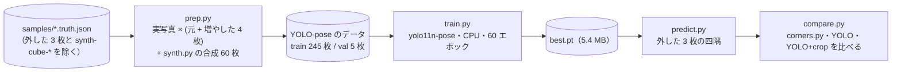

# TODO-135 の試作: YOLO-pose で四隅を当てる

## 分担

- main: 試作（データ作り・学習・比べる道具）と測定
- verifier: 測定の再現と、学習データに外した 3 枚が混ざっていないかの点検（報告は `verifier-report.md`）

## 道具



| ファイル | 中身 |
|---|---|
| `prep.py` | 学習データを作る。キーポイント 4 つ（TL・TR・BR・BL）、左右反転で TL↔TR・BR↔BL。盤の外を黒く塗った写真は、その黒をでたらめな背景に替えて、遠近の変形をかけた写しも作る |
| `train.py` | `yolo11n-pose.pt` から学習する（imgsz 640、mosaic なし、回転 ±10°） |
| `predict.py` | 学習したモデルで四隅を当て、JSON に書く（ultralytics の venv で動かす） |
| `compare.py` | 四隅のずれ（`check_corners.py` と同じ測り方）と、その四隅で `board.py` が読めたポイントの数を比べる（リポジトリの venv で動かす） |

再現する手順（リポジトリのトップで。`$V` は ultralytics と CPU 版 torch を入れた別の venv。モデルはリポジトリに入れていない）:

```bash
uv venv $V && VIRTUAL_ENV=$V uv pip install --index-url https://download.pytorch.org/whl/cpu \
  --extra-index-url https://pypi.org/simple --index-strategy unsafe-best-match torch torchvision ultralytics opencv-python-headless
uv run python archives/agents/TODO-135/prep.py $D 60                     # データ（数秒）
$V/bin/python archives/agents/TODO-135/train.py $D $R 60                 # 学習（16 コアの CPU で約 52 分）
H=(samples/photo4.truth.json samples/photo6.truth.json samples/collected-er0y2w.truth.json)
$V/bin/python archives/agents/TODO-135/predict.py $R/corners/weights/best.pt pred.json $H
uv run python archives/agents/TODO-135/compare.py pred.json $H
```

使った版: ultralytics 8.4.181、torch 2.14.1+cpu。

## 結果（2026-10-18、学習から外した 3 枚）

「YOLO+crop」は、YOLO の四隅を囲む範囲（縦横に 15% ずつ広げた範囲。`check_corners.py --crop` と同じ）だけを `corners.py` に探させたもの。
ずれは 3.6% 以内なら目で取った四隅と同じくらいに読める（`check_corners.GOOD`）。

| サンプル | 正解の四隅で読めた数 | corners.py のずれ | 読めた数 | YOLO のずれ | 読めた数 | YOLO+crop のずれ | 読めた数 |
|---|---|---|---|---|---|---|---|
| photo4 | 23 | 4.5% | 15 | 5.4% | 14 | 4.9% | 23 |
| photo6 | 18 | 3.8% | 16 | 10.8% | 8 | 6.4% | 18 |
| collected-er0y2w | 20 | 0.0% | 19 | 5.3% | 19 | 1.2% | 21 |
| 計（72 ポイント） | 61 | | 50 | | 41 | | 62 |

かかった時間（1 枚）: corners.py 0.7 秒、YOLO 0.06 秒（どちらも x86_64 の 16 コア）。

- **YOLO だけでは今より悪い。** どの写真でも盤のおおよその位置は当たるが、ずれは 5〜11% で、`corners.py` より大きい
  （photo6 は斜めの写真で、四角形がねじれた）。学習に使えた実写真は 50 枚で、検証の 5 枚の指標（pose mAP50 0.995）は当てにならない
- **YOLO+crop は読めた数が増えたが、四隅のずれはむしろ大きい**（photo4・photo6）。photo4 は盤の外の縁まで囲んでいるのに 23 読めた。
  今の読み取りは四隅が数画素動くだけで数ポイント変わる（`recognizer/README.md` の「精度」）ので、3 枚で 50 → 62 になったことを改善とは言い切れない
- 盤の外を黒く塗った collected-* が多く、そのまま学習すると「黒くない所が盤」と覚えるおそれがある。`prep.py` では黒を背景に替えて増やしたが、効いたかは測っていない

比べた 4 通りの四隅（緑 = 正解、赤 = corners.py、青 = YOLO、黄 = YOLO+crop）: `compare.jpg`

verifier の再現（`verifier-report.md`）: 12 の値がすべて一致し、学習データに外した 3 枚と synth-cube-* の名前は無かった。
名前でしか見ていない点は、`synth.py` は盤を色で描いていて写真を素材にしていないこと、同じ写真の別名は TODO-073 で消したことから、漏れは無いとみた。
