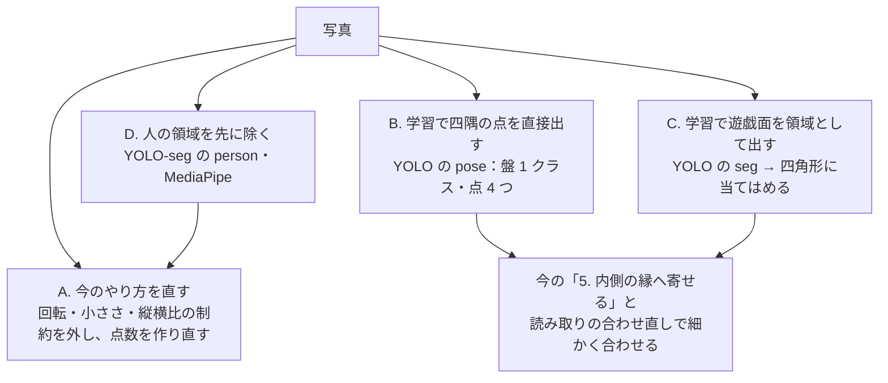

# 四隅の検出の手法の調査（TODO-067）

2026-10-18。今の `recognizer/corners.py`（recognizer 0.24.0）が外れる写真を分け、ほかの手法と比べた。
試しの実装はしていない。測ったのは今のやり方だけ（開発機で `check_corners.py` を 2 回）。

## 今のやり方の当たり具合

| 写真 | 3.6% 以内 | それより外れる | 見つからない |
|---|---|---|---|
| `samples/` の 67 枚 | 38 | 23 | 6 |
| 開発機の `collected/` の生の写真 41 枚（塗りつぶす前） | 14 | 24 | 3 |

- `samples/` で外れる 23 枚のうち 17 枚は 3.6〜6.0% のずれ。読み取りの合わせ直しでどこまで吸収されるかは測っていない
  （TODO-061 では、全体で四隅の候補から読むと 984 ポイント中 788、正解の四隅からは 895）
- `collected/` の正解は利用者がスマホで直した四隅なので、0.0% は「直さずに使えた」の意味。
  41 枚のうち 4 枚（xqv7k9・2hhe5o・mghnwm・ri4m9g）は横から撮った写真だが「横から撮った」の印が無く、普通の探し方で測ったため 57〜87% 外れている（今なら利用者が選べば `side.py` を使う）

### 外れ方の分類（`samples/` の大きく外れる・見つからない 12 枚）

幅・高さは `corners.py` と同じ測り方（上下・左右の辺の長さの平均を写真の幅・高さで割る）。

| 原因 | 写真 | 今のやり方の制約 |
|---|---|---|
| 盤が回っている | collected-4b88u3・5wxq9t・dplmij | 奥と手前の辺の傾きは 0.5 まで |
| 盤が小さい | collected-5wxq9t（幅 約 19%）・dplmij（約 24%）・sj1vrx（高さ 約 19%） | 幅が写真の 30% 以上、高さが 25% 以上 |
| 縦横比が範囲の外（端から強く斜めに撮った） | collected-gka56t・ydz20m・ajxlol（0.71〜0.74。ajxlol は奥の辺の傾き 0.52 も）、commons-rollup-oblique（2.32） | 縦横比 0.8〜2.2 |
| 横の辺が急 | collected-wkky1g（0.63）、commons-rollup-oblique（0.98） | 左右の辺の傾きは 0.5 まで |
| 候補はあるが点数で外側・内側を選ぶ | collected-6aj3py・m5ekpe、commons-case-dice | 三角形の並びの点数 |

12 枚のうち 9 枚は**点数ではなく、候補を作るときの制約**（傾き・大きさ・縦横比）で外れる。
これまでに制約を緩めた結果は分かれている。

- TODO-104: 傾きの上限を 0.3 → 0.5 に広げて採った（5 枚良くなり、2 枚悪くなったのをユーザーが受け入れた）。
  同じ項目で、写真を 90° 回しても探す処理を試したが、4b88u3 は傾きを 1.0 まで広げても 41%、5wxq9t は大きさの下限で拾えず、時間が約 2 倍になって外した
- TODO-078: 奥と手前の辺の傾きをさらに広げる案は、ほかの盤で間違った四角形が点数で勝ち、採らなかった
- TODO-061: 崩れたのは点数に項を足した案のほう。縦の縁の傾きを 0.5 にすると tad9pt は良くなった

残った外れ方（回転・小ささ・強い斜め）は、これ以上制約を緩めるか、別の探し方が要る。

この分類は塗った写真（`samples/`）で数えた。生の写真で大きく外れる 50ygdg（35.3%）・jixhl6（59.6%）・y6z4dd・kuetnz・2lb923・69ud59・oktnr4 などは分類していない。

### 背景の塗りつぶし処理が測り方に効いている

`samples/collected-*` は盤の外を黒くしてあるので、生の写真と結果が違う（m5ekpe 0.0% → 9.3%、6aj3py 0.4% → 11.8%、
逆に wkky1g 30.8% → 14.6%）。塗った境目が強い縁になるためと見ている（確かめていない）。
`samples/` の値は、人や背景が写った本当の写真での当たり具合を表していない。学習のデータに使うときも、塗った写真では「黒い縁の内側が盤」と覚えるおそれがある。

### 人が写っている写真

`samples/collected-*` は盤の外を塗ってあるので、人が原因かは生の写真で見た。生の 41 枚を縮小一覧で目視すると、
外れた 27 枚のうち、手や腕が盤の縁か盤の上に写っているのは約 9 枚（ajxlol・5vutmr・dplmij・ydz20m・gka56t・y6z4dd・7hgiow・50ygdg・oktnr4）。
**人が原因で外れたかは確かめていない**（同じ写真の多くは縦横比・小ささなど上の制約にも当たる）。外れなかった写真にも手の写ったものがある。

## 候補の手法

### A. 今のやり方を直す（学習なし）

- 回転: 勾配の向きの分布から盤の向きを先に求め、写真を回してから今の探し方に入る案。TODO-104 の 90° 回す案とは違うが、
  回った 2 枚は傾きを広げても大きさの下限でも拾えなかったので、効く根拠は無い
- 小ささ・縦横比・急な辺: 制約を緩める。候補が増え、点数が三角形頼みのままでは TODO-078 と同じく別の盤が崩れうる
- 線の検出を `cv2.createLineSegmentDetector` や `HoughLinesP` に替える案: 線の候補の質は上がりうるが、外れる原因の多くは線ではなく制約と点数なので、これだけでは効かない
- 三角形の無い盤は、点数を三角形に頼る限り扱えない（TODO-105 は外形から推す別の項目）
- 新しい依存は要らない。時間は開発機の `check_corners.py` で 1 枚 0.04〜0.95 秒（生の写真では 2.4 秒のものもある）。Pi 5 では測っていない

### B. 学習で四隅の点を出す（推奨）

盤の遊戯面を 1 つの物体とし、その四隅を順番つきの点（TL・TR・BR・BL）として出す姿勢推定のモデル（YOLOv8n-pose / YOLO11n-pose の形）を学習する。

- **三角形が無くても、回っていても、小さくても、斜めでも**、学習データにあれば扱える見込み。手で縁が隠れた写真も、そういう写真を入れれば覚える見込み
- 出る点は数 % ずれうるので、今の「5. 辺を内側の縁へ寄せる」と読み取りの合わせ直しで細かく合わせる。外れても利用者が直せる
- **点の順番**（どこが左上か）: 学習では「写真の手前側が下辺」と決め、横から撮った写真は今の印（`side`）で並べ替える。
  ただし TODO-104 では、回った盤（4b88u3）は「どちらが手前かが写真から決まらない」として向きを決め打ちにした。
  B が効くはずの回った写真ほど順番のラベルがあいまいになり、学習が揺れうる（確かめていない）。順番は付けずに 4 点を出し、並べ替えは後で決める形もありうる
- **Pi 5 の CPU での時間**: 公表値・報告では YOLOv8n/YOLO11n の検出（640 px）が NCNN で 70〜110 ms、ONNX Runtime で 170〜200 ms（数字は検索の要約で、元の表は確かめていない）。
  pose も同じ大きさの骨格なので同程度と見込む。今のやり方の Pi 5 での時間は測っていないので、速さの比べはまだできない
- **推論の依存**: ONNX に書き出せば、入っている OpenCV（5.0.0）の `cv2.dnn` で読める見込みで、そうなら新しい依存は要らない（読めるかも、その速さも確かめていない）。
  上の 70〜200 ms は NCNN・ONNX Runtime の値なので、その速さが要るなら `ncnn` か `onnxruntime` を足すことになる
- **学習データ**: 四隅の正解がある写真は、重なりを除くと約 85 枚（`samples/` 67 枚と `collected/` の生の写真 41 枚のうち、11 枚は同じ写真、synth-* 12 枚は photo2・photo4 の作り替え）。
  塗った写真を除くと約 69 枚。回転・射影・明るさ・切り抜きで水増しし、`recognizer/synth.py` の合成も使える。
  `collected/` の正解は、利用者が自動の四隅をそのまま受け入れたものも含むので、自動の推定のずれがラベルの誤差として入る。
  この枚数からの学習で足りるかは、試してみないと分からない
- **評価**: 学習に使った写真で `check_corners.py` を当てても比べにならない。学習用と評価用に分けるか、交差検証で比べる。
  採ったあとも、CI の `accuracy` は `samples/` で測るので、`samples/` を学習に使うと CI が良く見える。評価用の写真を学習から外して残す
- **学習済みの重み**: 100 枚程度では、COCO などで学習済みの重みから始めるのが一番効く。Ultralytics のライブラリと重みは AGPL-3.0
- **AGPL を避けるなら**: 小さなモデルを PyTorch で自前に書き、条件の合う学習済みの backbone（torchvision など。重みの条件は確かめていない）から始める。
  RTMPose は top-down で別に検出器が要り、MMPose・mmcv の依存も重いので、置き換えにはなりにくい
- 学習用に PyTorch などが開発機に要る（Pi には入れない。`--dev` か別の環境）

### C. 学習で遊戯面を領域として出す

YOLO-seg で遊戯面の領域を出し、`cv2.approxPolyDP` などで四角形に当てはめる。

- 一部が手で隠れても領域から四角形を推せる。ただし隠れた隅は当てはめが不安定
- 四隅の順番は別に決める必要がある（B は点に順番がつく）
- 時間は B より少し長い（seg の頭の分）。学習データは四隅から多角形を作れるので B と同じものが使える
- B より利点が少ないので、B がだめだったときの次の案

### D. 人の領域を先に除く

YOLOv8n-seg の person クラスや MediaPipe の人物セグメンテーションで人を消し、その画素を縁の計算から外す。

- 外れた写真で人が写っているのは約 1/3 で、原因かは確かめていない。効く範囲は大きくない見込み
- 手は写真の端から伸びた腕や、盤の上の指先として写る。person のセグメンテーションは体全体が写った人で学習されており、指先は取りこぼす見込み。
  MediaPipe の人物セグメンテーションは自撮り（顔が大きく写る）向けで、上から撮った手には合わない見込み（どちらも試していない）
- 盤の上の手を消すと、そこにある縁の画素も消える。左右の辺は「帯の行の 45% に縁が乗る」が条件なので、消した行を数え方から外さないと、かえって候補から落ちる
- モデルを 1 つ足して、その分の時間が増える
- B を採るなら要らない（手の写った写真を学習データに入れれば済む）

### E. Claude に選ばせる（今ある）

四隅の画面の「Claude で検出」（`BG_CLAUDE` を設定したサーバーだけ）。写真を外に送るので、既定の道にはしない。比べる対象としてだけ挙げる。

### F. 文書の四隅を出す学習済みのモデルを転用する

書類をスマホで撮って四隅を出すモデル（文書スキャナーのもの）は、四角形の四隅を出す点で B と同じ形。
盤で学習し直す元にすれば、少ない枚数という B の弱点を補えるかもしれない。ライセンスと Pi での速さは確かめていない。B を試すときに、学習済みの重みの候補として一緒に探す。

## 比べた結果

| | A. 今のやり方を直す | B. 学習で点 | C. 学習で領域 | D. 人を除く |
|---|---|---|---|---|
| 三角形の無い盤 | × | ○（見込み） | ○（見込み） | 今のやり方のまま |
| 回転・小さい・強い斜め | 90° 回す案は TODO-104 で効かなかった。緩めると点数が崩れうる | ○（データにあれば。回転は順番のラベルが課題） | ○ | 変わらない |
| 手で縁が隠れる | △ | ○（データにあれば） | ○ | △（指先は取りこぼす見込み） |
| 時間 | 開発機で 0.04〜0.95 秒。Pi 5 は測っていない | Pi 5 で NCNN 70〜110 ms・ONNX Runtime 170〜200 ms（公表値）。`cv2.dnn` では不明。＋寄せる処理 | B より少し長い | ＋モデル 1 つ分 |
| 新しい依存 | なし | `cv2.dnn` で読めればなし。速さが要れば `ncnn` か `onnxruntime`。学習に PyTorch | B と同じ | モデルと推論の実行環境 |
| 手間 | 中（TODO-078 で崩れ、TODO-104 の回転も外した） | 大（学習の環境・データ作り・評価用の分け方） | 大 | 中 |
| どの機械でも同じ答え | ○（整数） | float。TODO-074 で気にしないと決めた | 同じ | 同じ |

## 推奨

**B（学習で四隅の点を出し、今の寄せる処理で細かく合わせる）を別の項目で試す。** 残った外れ方（回転・小ささ・強い斜め）は今のやり方の制約から来ており、
TODO-104 では回転を試して拾えず、TODO-078 では緩めると別の盤が崩れた。B は制約そのものを持たない。

試すときの順:

1. 下の「決めること」を先に決める
2. 評価用の写真を学習から外して残し、残りと水増しで開発機で小さく学習し、評価用の写真で `check_corners.py` と同じ物差し（3.6% 以内の数）で今と比べる
3. 今より良ければ、ONNX に書き出して `cv2.dnn` で Pi 5 の時間を測る（今のやり方の Pi 5 の時間も一緒に測る）

D は単独では採らない。A の回転は TODO-104 で効かなかったので、B がだめだったときも、まず別の探し方を考え直す。

## 決めること（ユーザー）

- **ライセンス**: リポジトリに LICENSE が無い。Ultralytics（AGPL-3.0）を使うなら、先にリポジトリのライセンスを決める。避けるなら B の「AGPL を避けるなら」の形
- **学習した重みを公開リポジトリに入れてよいか**: `collected/` の写真（顔が写っているものがあり、リポジトリに入れない）から学習した重みは、CLAUDE.md の写真の扱いに書いていない。
  入れないなら、学習に `samples/` だけを使うか、重みを開発機と Pi にだけ置く

## 参考

- 測った値: `archives/agents/TODO-067/check_corners-main.txt`（`samples/`）、`check_corners-collected-raw.txt`（`collected/` の生の写真）
- レビュー: `archives/agents/TODO-067/reviewer-report.md`
- [Ultralytics: Raspberry Pi のガイド（Pi 5 での形式ごとの比べ）](https://docs.ultralytics.com/guides/raspberry-pi)
- [Ultralytics コミュニティ: Pi 5 での YOLOv11n NCNN の報告](https://community.ultralytics.com/t/raspberry-pi-5-crash-when-running-yolov11n-ncnn/1525)
