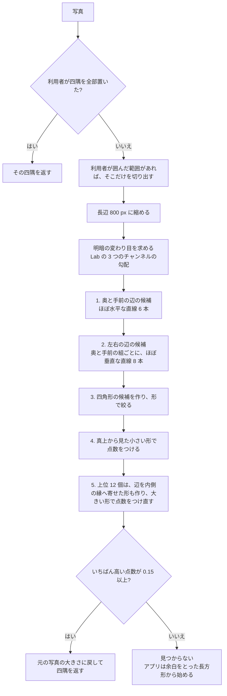
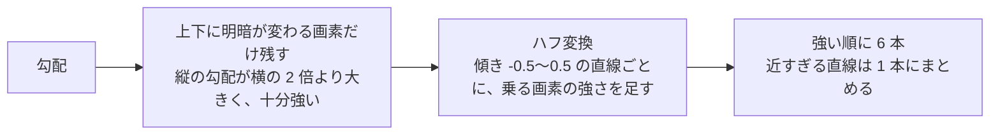
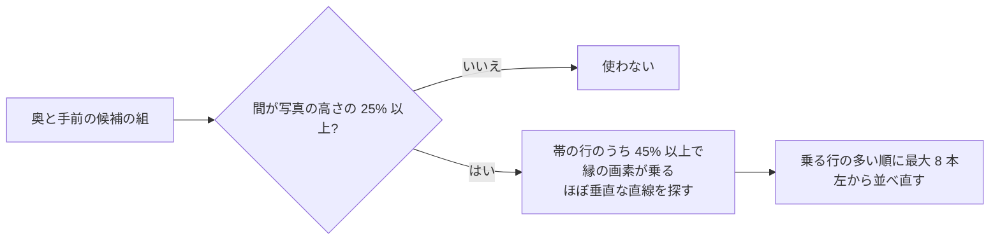
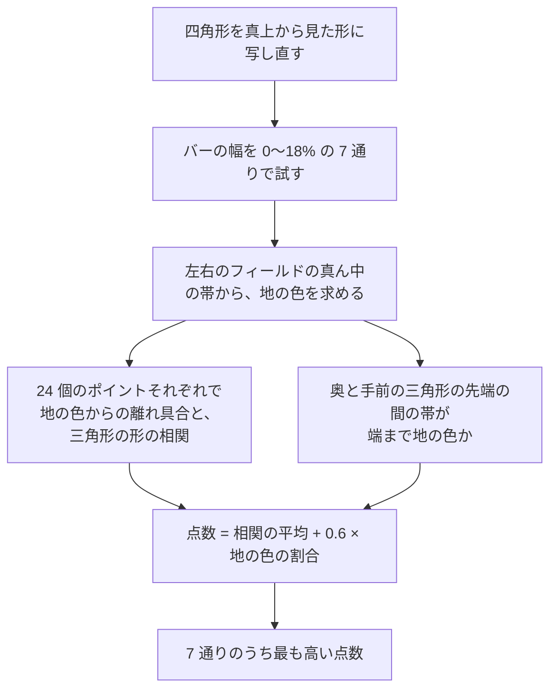
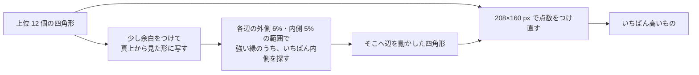

# 盤の四隅の検出のしくみ

写真を読み込むと、アプリはまず盤の遊戯面（左右のフィールドとバー、枠の内側）の四隅を推定して、四隅の画面に初期値として出します。
利用者はそれをドラッグで直してから解析します。推定するのは `recognizer/corners.py` の `find_corners` です。
定数の値や、サンプルでの当たり具合は [recognizer/README.md](../recognizer/README.md) の「四隅の推定」にあります。

## 考え方

遊戯面は、4 本の長い直線で囲まれています。

- **奥の辺と手前の辺**: 枠の縁。三角形の底辺がここに並ぶ
- **左の辺と右の辺**: 枠の縁

そこで、写真から「長い直線」を探して四角形の候補をたくさん作ります。それぞれを真上から見た形に直し、
**24 個の三角形が 2 列に並んで見えるか**で点数をつけ、いちばん盤らしいものを答えにします。
長い直線は盤の縁のほかにも（ケースの縁、バーなど）あるので、どの四角形を選ぶかは、直線ではなく盤の中身（三角形の並び）で決めます。

## 全体の流れ

探す途中の段階（奥と手前の辺、左右の辺、候補の四角形）は、終わるたびにアプリへ送られ、四隅の画面に途中経過として描かれます。
途中経過を出しても、見つかる四隅は変わりません。

## 1. 奥と手前の辺の候補

- 傾きを 0.5（約 27°）まで試すのは、対局者の横から撮った斜めの写真でも奥の辺が入るようにするためです。
- ハフ変換は「この直線の上に、縁らしい画素がどれだけ乗っているか」を、すべての直線について数える方法です。整数だけで数えています。

## 2. 左右の辺の候補

奥と手前の候補から 2 本を選ぶたびに、その 2 本に挟まれた帯の中で、ほぼ垂直な直線を探します。

- 決め手は「帯の行の 45% 以上に縁の画素が乗っているか」です。三角形の辺は盤の高さの半分も続かないので落ち、枠・バー・ケースの縁が残ります。
- どの帯でも速く数えられるように、直線ごとの「縁の画素が乗った行の数」を、4 行ごとの累積で先に作っておきます。

## 3. 四角形の候補

奥と手前の 2 本と、左右の 2 本の交点 4 つで四角形を作ります。次の四角形は捨てます。

- 横と縦の比が 0.8〜2.2 の外にあるもの
- 幅が写真の幅の 30% より狭いもの（利用者が範囲を囲んだときは、範囲の幅の 50%・高さの 40% より小さいもの）
- 利用者が置いた隅があるとき、その隅から、探す範囲（囲んだ範囲、無ければ写真全体）の長辺の 5% より離れているもの（残ったものは、その隅を利用者の位置に置き換える）
- 前に見たものとほぼ同じもの

## 4. 盤らしさの点数

候補の四角形を、真上から見た長方形（最初は 104×80 px）に写し直して点数をつけます。

- **三角形の形の相関**: 各ポイントの場所で、地の色と違う画素が三角形の形に並んでいれば高くなります。三角形の色そのものは見ないので、どんな配色の盤でも使えます。
- **先端の間の帯**: 盤なら、奥と手前の三角形の先端の間は地の色が続きます。ケースや枠まで取り込んだ四角形は、ここで点を落とします。

## 5. 辺を内側の縁へ寄せる

枠には段や面取りがあり、外側の縁の方が強く写ることが多いので、ずれた辺で四角形ができやすくなります。
そこで、点数の高い 12 個については、各辺を近くの「いちばん内側の強い縁」へ動かした形も作ります。

- 左右の辺は、三角形の先端の間の高さで探します。そこでは枠とフィールドの境目しか無いので、三角形の辺に引っ張られません。

## どの機械でも同じ答えになるように

縮小も勾配もハフ変換も整数で計算し、射影変換などは `recognizer/exact.py` の、どの CPU でも同じに丸まる計算で行っています。
そのため、開発機（x86_64）と Raspberry Pi で、見つかる四隅は同じです。

## 苦手なもの

しくみから考えると、次のような写真は苦手になりえます（どれだけ外れるかは測っていません）。

- **三角形の見えない盤**: 点数は三角形の並びで決まるので、辺は見つかっても点数が低くなりえます
- **辺が 27° より傾いた写真**: 試す傾きの外なので、その辺の候補が出ません
- **縁が途切れて見える写真**: 左右の辺は、帯の行の 45% 以上に縁の画素が乗らないと候補になりません。手や物で縁が隠れると、届かないことがありえます

見つからなかったり外れたりしたときは、利用者が四隅を直します。直したあとの「再検出」では、置いた隅を固定し、囲んだ範囲だけを探し直します（上の流れの「利用者が置いた隅」「囲んだ範囲」）。
四隅の画面の「Claude で検出」は、これとは別の道で、写真を Claude に見せて四隅を選ばせます（`BG_CLAUDE` を設定したサーバーだけ）。

## 横から撮った写真（TODO-120）

盤の真横から撮った写真では、バーが写真を横切り、長い辺（三角形の付け根の側）が写真の上へ向かって狭まります。上の探し方は奥と手前の辺がほぼ水平な写真を前提にしているので、
アプリで「横から撮った」を選んだときは `recognizer/side.py` の探し方に替えます。

- 先に長い辺を探します（写真の縦の向きに長く続く直線。傾きは 45° まで）。次に、2 本の長い辺の間を横切る線から両端を探します
- 両端の幅を比べ、カメラ側（写真の下）が広く奥が狭い台形だけを残します
- 点数は上と同じ「盤らしさの点数」で、最後に辺を内側の縁へ寄せます（「5.」）
- 右から撮った写真では写真の右上が左上（手前の人から見て）、右下が右上、左下が右下、左上が左下です。左から撮った写真は盤を半回転させたのと同じ形なので、同じ探し方で見つけ、順だけを入れ替えます（写真の左下が左上）

横から撮った 6 枚での誤差（写真の長辺に対するずれ）は 1.7〜11.5% です。点数が横からの写真に合っておらず、三角形の付け根を切った四角形が勝つことがあります。

## 四隅のあと

ここで見つけた四隅は、読み取り（`recognizer/board.py`）の入口になります。読み取りでは、三角形の並びに合わせて四隅をもう一度細かく合わせ直してから駒を読みます。
四隅の画面で「四隅を固定する」を選ぶと、この合わせ直しをせず、渡した四隅のまま読みます。
