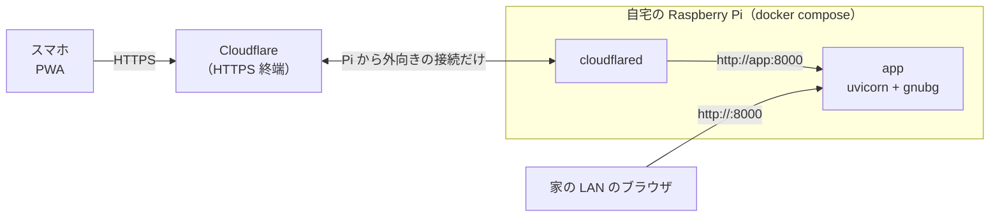

# 自宅の Raspberry Pi で公開する

アプリ（API と PWA）を自宅の Raspberry Pi で常駐させ、Cloudflare Tunnel で `https://<自分のドメイン>/` から
スマホで使えるようにする手順です（TODO-002）。



- ルーターのポート開放や固定 IP は要りません。Pi から Cloudflare へ外向きにつなぐだけです。
- HTTPS の証明書は Cloudflare が用意するので、ホーム画面への追加（PWA のインストール）ができます。
- 写真は Pi で処理するだけで保存しません。

## 用意するもの

| もの | 内容 |
|---|---|
| Raspberry Pi | Pi 4 か Pi 5、メモリ 2GB 以上を推奨。**64bit の Raspberry Pi OS**（Bookworm 以降） |
| Cloudflare のアカウント | 無料プランで足ります |
| ドメイン | Cloudflare で管理しているもの（Cloudflare で買うか、ネームサーバーを Cloudflare に向ける）。年1,500円前後から |

ドメインがない場合の試し方は最後の「ドメインなしで試す」にあります（URL が毎回変わるので常用には向きません）。

## 1. Pi の準備

64bit の OS か確かめます。`aarch64` と出れば OK です（`armv7l` なら 32bit なので入れ直してください）。

```bash
uname -m
```

Docker を入れて、sudo なしで使えるようにします（入れたらログインし直す）。

```bash
curl -fsSL https://get.docker.com | sh
sudo usermod -aG docker $USER
```

## 2. アプリを起動して LAN で確かめる

```bash
git clone https://github.com/ytani01/bganalyzer.git
cd bganalyzer
docker compose up -d --build app
```

初回のビルドは時間がかかります。GNU Backgammon（gnubg）の Python パッケージには arm64 用のビルド済みのものがないので、
Dockerfile がソースからビルドします（Pi 4 で 10〜20 分ほどの見込み）。2回目以降はキャッシュが効きます。

起動したら、同じ LAN の PC かスマホで `http://<PiのIP>:8000/` を開いて、写真の解析ができることを確かめます。
Pi の IP は `hostname -I` でわかります。

## 3. Cloudflare Tunnel を作る（ブラウザで）

1. https://dash.cloudflare.com/ で、使うドメインが追加されていることを確かめる。
2. 左のメニューの **Zero Trust** を開く（初回はチーム名と Free プランの選択を聞かれる）。
3. **Networks → Tunnels → Create a tunnel** → **Cloudflared** を選び、名前（例: `bganalyzer-pi`）を付ける。
4. インストール方法の画面で **Docker** を選ぶと `docker run ... --token eyJ...` というコマンドが出る。
   この `eyJ` で始まる長い文字列（トークン）だけをコピーする。コマンド自体は実行しない。
5. **Public Hostname**（ルート）を追加する。
   - Subdomain: 例 `bg`、Domain: 自分のドメイン → `https://bg.<ドメイン>/` になる
   - Service: Type **HTTP**、URL **`app:8000`**
6. 保存する。

## 4. Tunnel を起動する

Pi の `bganalyzer` フォルダに `.env` を作り、トークンを書きます。`.env` は Git に入れません（`.gitignore` 済み）。

```bash
echo 'TUNNEL_TOKEN=eyJ...（コピーしたトークン）' > .env
chmod 600 .env
docker compose up -d
docker compose ps        # app と cloudflared が Up になっていること
```

スマホで `https://bg.<ドメイン>/` を開き、解析できたら、ブラウザのメニューから「ホーム画面に追加」します。

## ふだんの運用

| やること | コマンド（`bganalyzer` フォルダで） |
|---|---|
| 新しい版に更新する | `git pull && docker compose up -d --build` |
| ログを見る | `docker compose logs -f app`（Tunnel は `cloudflared`） |
| 止める | `docker compose down` |

- Pi を再起動しても、Docker が自動で立ち上げ直します（`restart: unless-stopped`）。
- 更新は `main` を pull してビルドし直すだけです。依存が変わっていなければ数分で終わります。

## 自分だけが使えるようにする（任意）

URL を知っていれば誰でも使える状態です。家族や自分だけに絞りたいときは、Zero Trust の
**Access → Applications → Add an application → Self-hosted** で `bg.<ドメイン>` を登録し、
ポリシーで使ってよいメールアドレスを指定します。開くとメールに届くコードでログインするようになります。

## ドメインなしで試す

ドメインがなくても、一時的な URL で HTTPS を試せます（Pi を再起動するたびに URL が変わり、ホーム画面に追加しても使えなくなります）。

```bash
docker compose up -d --build app
docker run --rm --network bganalyzer_default cloudflare/cloudflared:latest tunnel --no-autoupdate --url http://app:8000
```

ログに出る `https://<ランダム>.trycloudflare.com` をスマホで開きます。止めるときは Ctrl+C です。

## うまくいかないとき

- **ビルドが途中で止まる・Pi が固まる:** メモリ不足の可能性があります。メモリ 1GB の Pi ではスワップを増やすか、Pi 4/5（2GB 以上）を使ってください。
- **`TUNNEL_TOKEN` のエラーで起動しない:** `.env` が `compose.yaml` と同じフォルダにあり、`TUNNEL_TOKEN=` で始まっているか確かめます。アプリだけなら `docker compose up -d app` で起動できます。
- **https で開くと 502 になる:** Public Hostname の Service が `http` / `app:8000` になっているか、`docker compose ps` で app が動いているかを確かめます。
