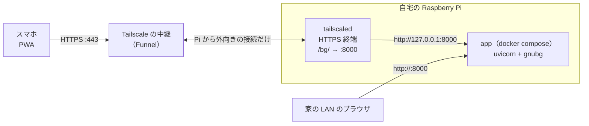
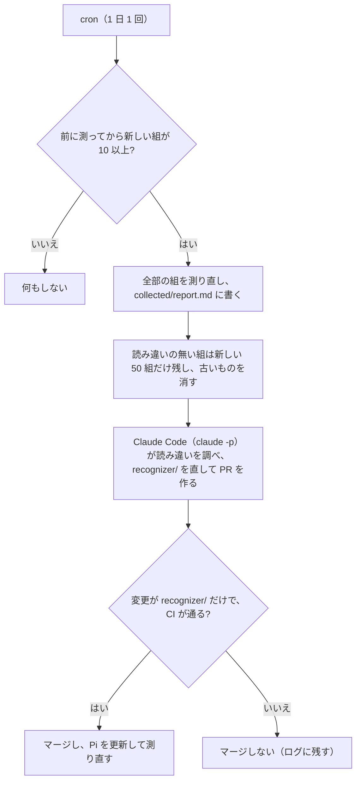

# 自宅の Raspberry Pi で公開する

アプリ（API と PWA）を自宅の Raspberry Pi で常駐させ、Tailscale Funnel で
`https://<Piの名前>.<tailnet名>.ts.net/bg/` からスマホで使えるようにする手順です（TODO-002）。



- 費用はかかりません（Tailscale の個人向け無料プラン）。ドメインもルーターのポート開放も要りません。
- HTTPS の証明書は Tailscale が用意するので、ホーム画面への追加（PWA のインストール）ができます。
- このアプリは `/bg/` の下に置きます。同じ Pi で別のアプリを公開するときは、`/other/` のように別のパスに足せます。
- 写真は Pi で処理するだけで保存しません。

## 用意するもの

| もの | 内容 |
|---|---|
| Raspberry Pi | Pi 4 か Pi 5、メモリ 2GB 以上を推奨。**64bit の Raspberry Pi OS**（Bookworm 以降） |
| Tailscale のアカウント | 無料。Google・Microsoft・GitHub などのアカウントでログインして作れます |

## 1. Pi の準備

64bit の OS か確かめます。`aarch64` と出れば OK です（`armv7l` なら 32bit なので入れ直してください）。

```bash
uname -m
```

Docker を入れて、sudo なしで使えるようにします（入れたらログインし直す）。

```bash
curl -fsSL https://get.docker.com | sh
sudo usermod -aG docker $USER
```

## 2. アプリを起動して LAN で確かめる

```bash
git clone https://github.com/ytani01/bganalyzer.git
cd bganalyzer
docker compose up -d --build
```

初回のビルドは時間がかかります。GNU Backgammon（gnubg）の Python パッケージには arm64 用のビルド済みのものがないので、
Dockerfile がソースからビルドします（GitHub の arm64 マシンでは gnubg のビルドが 30 秒ほど。Pi 4 ではその数倍かかる見込み）。2回目以降はキャッシュが効きます。

起動したら、同じ LAN の PC かスマホで `http://<PiのIP>:8000/` を開いて、写真の解析ができることを確かめます。
Pi の IP は `hostname -I` でわかります。

## 3. Tailscale を入れて Funnel で公開する

```bash
curl -fsSL https://tailscale.com/install.sh | sh
sudo tailscale up
```

`tailscale up` が表示する URL をブラウザで開き、Tailscale にログインして Pi を登録します。

次に、`/bg/` を Pi の 8000 番につないでインターネットに公開します。

```bash
sudo tailscale funnel --bg --set-path /bg http://127.0.0.1:8000
```

初めてのときは、HTTPS と Funnel を有効にするための URL が表示されます。ブラウザで開いて許可し、同じコマンドをもう一度実行します。
公開された URL は次で確かめられます。

```bash
tailscale funnel status
```

スマホ（Tailscale のアプリは要りません）で `https://<Piの名前>.<tailnet名>.ts.net/bg/` を開き、解析できたら、
ブラウザのメニューから「ホーム画面に追加」します。

- `--bg` を付けたので、Pi を再起動しても公開は続きます。
- URL の `<Piの名前>` は Tailscale の管理画面（Machines）で変えられます（例: `bg`）。`<tailnet名>` は DNS の設定で1回だけ好きな候補に変えられます。
  ホーム画面に追加したあとで変えると URL が変わるので、変えるなら先に変えておきます。

## ふだんの運用

| やること | コマンド（`bganalyzer` フォルダで） |
|---|---|
| 新しい版に更新する | `git pull && docker compose up -d --build` |
| 動いている版を見る | `curl http://127.0.0.1:8000/version`（アプリの画面のいちばん下にも出ます） |
| ログを見る | `docker compose logs -f app` |
| 止める | `docker compose down` |
| 公開の設定を見る | `tailscale funnel status` |

- Pi を再起動しても、Docker がアプリを自動で立ち上げ直します（`restart: unless-stopped`）。
- 更新は `main` を pull してビルドし直すだけです。依存が変わっていなければ数分で終わります。
- 更新したら [PI_CHECKS.md](PI_CHECKS.md) の未確認の項目を確かめます（Pi の上の Claude Code に「PI_CHECKS を確かめて」と頼めます）。

## 精度改善用に集めた写真（`collected/`）

PWA の「解析の設定」で「Pi に残す」をオンにすると、解析するたびに写真と直した後の盤面が
`bganalyzer/collected/` に `user-<id>.jpg` と `user-<id>.truth.json` の組で入ります（同じ写真を直し直すと上書き。上限 1000 組）。
中身は `samples/*.truth.json` と同じ形で、認識が読んだ盤面（`read`）と直したポイント（`fixed_points`）も入っています。
コンテナが root で書くので、消すときは `sudo rm` を使います。

| やること | コマンド（`bganalyzer` フォルダで） |
|---|---|
| 何組あるか | `ls collected/*.truth.json \| wc -l` |
| 今の認識で測る | `docker compose exec app sh -c 'python recognizer/evaluate.py /data/samples/*.truth.json'` |
| 直した所の多い写真を見る | `grep -o '"fixed_points": \[[^]]*\]' collected/*.truth.json` |

### 自動で測り直す

`tools/collected_cron.sh` を cron から 1 日 1 回走らせると、次のことを自動で行います。



- 読み違いのある組は直す材料なので消しません。読み違いの無い組は、直したことでほかが悪くならないかを確かめるのに使います。
- `claude -p` に渡す指示は `tools/collected_prompt.md` です。公開の `/samples` からは誰でも写真と正解を送れるので、
  `claude -p` には `.truth.json` を直接読ませず、使えるコマンドも絞っています。マージの前に、スクリプトが変更の範囲と CI を確かめます。
- Pi の `bganalyzer` が `main` で、変更が無いときだけ動きます（作業中なら止まります）。

`crontab -e` に次の 1 行を足します（毎日 4 時）。ログは `~/collected-cron.log` に残ります。

```
0 4 * * * $HOME/work/bganalyzer/tools/collected_cron.sh >> $HOME/collected-cron.log 2>&1
```

すぐに試すときは `tools/collected_cron.sh --force`（10 組たまっていなくても測ります）。

リポジトリの `samples/` へは自動では入れません。公開リポジトリなので、入れる写真は人の顔などが写っていないものを選んで、
PR で足します（[CLAUDE.md](../CLAUDE.md)）。

## 同じ Pi で別のアプリも公開する

アプリごとに別のポートで動かし、別のパスに割り当てます。例えば 8001 番で動くアプリを `/other/` に出すには:

```bash
sudo tailscale funnel --bg --set-path /other http://127.0.0.1:8001
```

Tailscale はパスの部分（`/bg` など）を取り除いてからアプリに渡します。このアプリは相対パスで API を呼ぶので、`/bg/` の下でもそのまま動きます。
パスを分けずにポートで分けることもできますが、Funnel で使えるポートは 443・8443・10000 の3つだけです。

## 自分だけが使えるようにする（任意）

Funnel の URL は、知っていれば誰でも開けます。自分や家族だけにしたいときは、Funnel の代わりに `serve`（Tailscale の中だけに公開）を使い、
使うスマホにも Tailscale のアプリを入れて同じアカウントでログインします。

```bash
sudo tailscale funnel reset      # Funnel の設定を消す（ほかのパスの設定も消えます）
sudo tailscale serve --bg --set-path /bg http://127.0.0.1:8000
```

## うまくいかないとき

- **ビルドが途中で止まる・Pi が固まる:** メモリ不足の可能性があります。メモリ 1GB の Pi ではスワップを増やすか、Pi 4/5（2GB 以上）を使ってください。
- **https で開くと 502 になる:** `docker compose ps` で app が動いているか、`curl http://127.0.0.1:8000/health` が `{"ok":true}` を返すかを確かめます。
- **スマホで開けない:** `tailscale funnel status` で `/bg` がインターネットに公開（Funnel）になっているか確かめます。公開直後は DNS が行き渡るまで数分かかることがあります。
- **Pi の名前を変えたあと、スマホで `NET::ERR_CERT_COMMON_NAME_INVALID` になる:** 新しい名前が公開 DNS に載っていません
  （`dig +short @1.1.1.1 <Piの名前>.<tailnet名>.ts.net` が何も返さない）。Pi の中から開くと MagicDNS で直接つながるので、Pi からは気づけません。
  Funnel を一度オフにしてオンに戻すと、数分で載ります。

  ```bash
  sudo tailscale funnel --https=443 off && sudo tailscale funnel --bg --set-path /bg http://127.0.0.1:8000
  ```
