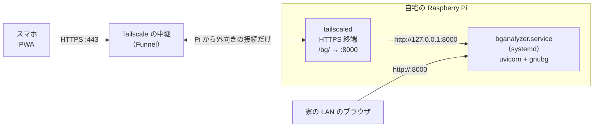
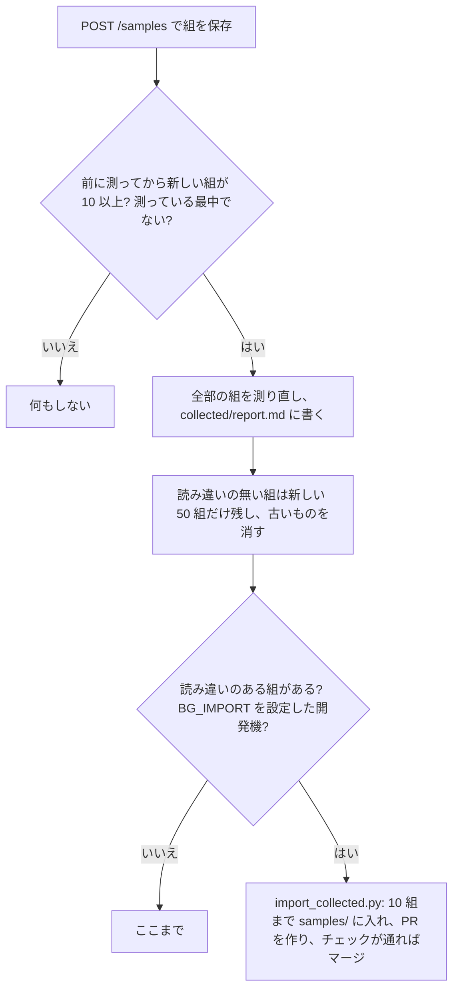

# 自宅の Raspberry Pi で公開する

アプリ（API と PWA）を自宅の Raspberry Pi で常駐させ、Tailscale Funnel で
`https://<Piの名前>.<tailnet名>.ts.net/bg/` からスマホで使えるようにする手順です（TODO-002）。



- 費用はかかりません（Tailscale の個人向け無料プラン）。ドメインもルーターのポート開放も要りません。
- HTTPS の証明書は Tailscale が用意するので、ホーム画面への追加（PWA のインストール）ができます。
- このアプリは `/bg/` の下に置きます。同じ Pi で別のアプリを公開するときは、`/other/` のように別のパスに足せます。
- 写真は Pi で処理するだけで保存しません（PWA の盤面の画面の「サーバーに［保存する］」のとき（既定）だけ保存する。下の「精度改善用に集めた写真」）。

## 用意するもの

| もの | 内容 |
|---|---|
| Raspberry Pi | Pi 4 か Pi 5、メモリ 2GB 以上を推奨。**64bit の Raspberry Pi OS**（Bookworm 以降） |
| Tailscale のアカウント | 無料。Google・Microsoft・GitHub などのアカウントでログインして作れます |

## 1. Pi の準備

64bit の OS か確かめます。`aarch64` と出れば OK です（`armv7l` なら 32bit なので入れ直してください）。

```bash
uname -m
```

[uv](https://docs.astral.sh/uv/) を入れます。Pi を再起動したあとも、ログインしなくてもアプリが動くようにします（systemd のユーザー unit を使うため）。

```bash
curl -LsSf https://astral.sh/uv/install.sh | sh
sudo loginctl enable-linger $USER
```

`uv` のコマンドが使えるように、入れたらログインし直します。

## 2. アプリを起動して LAN で確かめる

```bash
git clone https://github.com/ytani01/bganalyzer.git
cd bganalyzer
uv sync --frozen
mkdir -p ~/.config/systemd/user collected
sed "s|@DIR@|$PWD|g" bganalyzer.service > ~/.config/systemd/user/bganalyzer.service
systemctl --user daemon-reload
systemctl --user enable --now bganalyzer
```

`bganalyzer.service` の `@DIR@` をこのフォルダに置き換えて入れます。フォルダを移したら、同じ `sed` からやり直します。

GNU Backgammon（gnubg）の Python パッケージは PyPI に arm64 用が無いので、このリポジトリの Release に置いた wheel を使います
（`.github/workflows/gnubg-wheel.yml` でビルド。`uv.lock` が指している）。Pi の上でも `uv sync` / `uv run` はクラウドと同じに使えます。

起動したら、同じ LAN の PC かスマホで `http://<PiのIP>:8000/` を開いて、写真の解析ができることを確かめます。
Pi の IP は `hostname -I` でわかります。

## 3. Tailscale を入れて Funnel で公開する

```bash
curl -fsSL https://tailscale.com/install.sh | sh
sudo tailscale up
```

`tailscale up` が表示する URL をブラウザで開き、Tailscale にログインして Pi を登録します。

次に、`/bg/` を Pi の 8000 番につないでインターネットに公開します。

```bash
sudo tailscale funnel --bg --set-path /bg http://127.0.0.1:8000
```

初めてのときは、HTTPS と Funnel を有効にするための URL が表示されます。ブラウザで開いて許可し、同じコマンドをもう一度実行します。
公開された URL は次で確かめられます。

```bash
tailscale funnel status
```

スマホ（Tailscale のアプリは要りません）で `https://<Piの名前>.<tailnet名>.ts.net/bg/` を開き、解析できたら、
ブラウザのメニューから「ホーム画面に追加」します。

- `--bg` を付けたので、Pi を再起動しても公開は続きます。
- URL の `<Piの名前>` は Tailscale の管理画面（Machines）で変えられます（例: `bg`）。`<tailnet名>` は DNS の設定で1回だけ好きな候補に変えられます。
  ホーム画面に追加したあとで変えると URL が変わるので、変えるなら先に変えておきます。

## ふだんの運用

| やること | コマンド（`bganalyzer` フォルダで） |
|---|---|
| 新しい版に更新する | `git pull && uv sync --frozen && systemctl --user restart bganalyzer` |
| 動いている版を見る | `curl http://127.0.0.1:8000/version`（アプリの画面のいちばん下にも出ます） |
| ログを見る | `journalctl _SYSTEMD_USER_UNIT=bganalyzer.service -f`（`adm` グループに入っていれば sudo は要らない。`journalctl --user` では見えない） |
| 止める | `systemctl --user stop bganalyzer`（Pi を再起動すると、また立ち上がる） |
| 公開の設定を見る | `tailscale funnel status` |
| 開発機で画面を開いておく | `uv run -q --no-project --with playwright python tools/live_view.py`（スマホ（Pixel 9a）の大きさ 412×848 の Chromium の窓で開き、サービスが別のコミットで動き出すたびに再読み込みする。窓を閉じると終わる。別の URL は引数で。窓の中でダウンロードしたファイル（「ファイルに書き出す」など）は `~/Downloads` に保存する（同じ名前があれば `名前 (1).拡張子` のように変える）。開いている間は、`tools/pi_ui_check.py`・`tools/ui_snapshot.py` に `BG_CDP=http://127.0.0.1:9222` を付けて動かすと、見えない Chromium の代わりにこのブラウザの中に窓を開いて操作するので、確認の様子が見える） |

- Pi を再起動しても、落ちても、systemd がアプリを自動で立ち上げ直します（`Restart=always`）。
- 更新は `main` を pull して依存を揃え、立ち上げ直すだけです。`bganalyzer.service` が変わったときだけは、「2.」の `sed` から `enable --now` までをやり直し、`systemctl --user restart bganalyzer` します。
- 取り込み後の確認は Pi ではなくローカルホスト（開発機）で行います（下の「更新したあとに確かめる」）。

## 更新したあとに確かめる

main に取り込んだあと動いているアプリでしか確かめられないことは、TODO.md のその項目に `- [ ] ローカル:` / `- [ ] スマホ:` の行で書いてあります（2026-10-17 までは docs/PI_CHECKS.md で別に管理していた。決着した 50 件は `archives/pi/`）。
確かめるのは Pi ではなくローカルホスト（開発機）です。開発機にもこのページの手順で `bganalyzer.service` を入れておき、`git pull && uv sync --frozen && systemctl --user restart bganalyzer` で更新してから、`- [ ] ローカル:` の行を確かめて結果を書き込みます。スマホの画面の操作は、まず下の「スマホの代わりに確かめる」で確かめ、それでも確かめられないこと（実際の音声、iPhone の共有の画面など）だけを `- [ ] スマホ:` に残してユーザーに頼みます。

### スマホの代わりに確かめる

ローカルホストで、Playwright から `http://127.0.0.1:8000/` の PWA をスマホと同じ画面の大きさで操作する。
ブラウザは `/usr/bin/chromium` を使い、Playwright は `uv run --no-project` でその場で入れる
（pyproject.toml には入れていない）。

```bash
uv run -q --no-project --with playwright python tools/pi_ui_check.py           # 全部
uv run -q --no-project --with playwright python tools/pi_ui_check.py collect   # 名前を並べると、その確認だけ
```

1 つ失敗すると終了コードが 1 になる。どれも `samples/screen-app-grey-shot.png`（ダイス 4-2 の写ったアプリの画面）を読み取ってから確かめる。

| 名前 | 確かめること |
|---|---|
| `double` | キューブを片側にして「…にダブル」を選んだまま読み取っても、写真のダイスで最善手が出て、キューブの説明は出ない（ダイスがあるとき `#cube-help` は空で隠れる） |
| `speech` | 「読み上げ」ボタンで読み上げる文（`/speech` に 1 文ずつ頼む分をつないだもの）が、最善手を含み、`%`・「勝率」・ピップの数（「ピップ数では…」は読むが数字は読まない）・小数を含まない（音声は出さず、文だけを取り出す） |
| `export` | 「読み取りの改善」の「ファイルに書き出す」で、写真と `.truth.json` の 2 つがダウンロードされ、盤面とダイスが画面と同じ（共有の画面が無いときの動き） |
| `export-denied` | `export` と同じことを、共有の画面がファイルを断る（`NotAllowedError`、Android の Chrome が `.json` を断るとき）ときに確かめる |
| `collect` | 盤面の画面の「読み取りの改善」の「サーバーに［保存する］［保存しない］」を押して切り替える。保存しないなら `collected/` が増えず、保存するなら 1 組でき、`evaluate.py` で測れる。作った組はそのあと消す |

画面の操作が要る項目を足したら、ここにも確認を足す。

### クラウドから確かめられること

Pi のアプリは Tailscale Funnel で https://bg.tail5c266.ts.net/bg/ に公開している（ルートの `/` は 404）。
クラウドの Claude もここには届くので、**外から見えることはクラウドで先に確かめ、TODO.md の `ローカル:` の行に「クラウドから」と書いてよい。**

```bash
uv run python tools/check_pi.py          # --all で samples/ の全部
```

`/version`（版とコミット、main からコードが変わっていないか）、静的ファイルが手元と同じか、
`samples/` の公開写真 5 枚を `/analyze-photo`（0-ply）に送り、Pi の読み取りが手元と同じか・正解と何点合うかを出す。
画面は Playwright の Chromium で `/bg/` を開けば見られる。
クラウドの環境によっては、プロキシが ts.net を通さず `Tunnel connection failed: 403` になる（2026-10-14、引き継ぎ先のアカウントで確認）。
そのときでも、Claude の WebFetch ツールでは GET（`/bg/version` など）が読めることがある（2026-10-14、同じアカウントで確認）。
POST（`/analyze-photo`）は送れないので、読み取りの確認はローカルホストで行う。

クラウドからは**やらない・できない**こと（ローカルホストの Claude Code かユーザーに残す）:

- `git pull` と `systemctl --user restart bganalyzer`（Pi の更新そのもの）、アプリのログ、`collected/` の中身
- `/samples` に送ること（Pi に写真が残る）。送ってよいのはリポジトリで公開している `samples/` の写真だけ
- スマホ実機での操作（カメラ、共有、読み上げ、ホーム画面のアプリ）

## Claude に四隅を選ばせる（任意）

四隅の画面に「Claude で検出」ボタンを出せます（TODO-082）。押すとサーバーが `claude -p` に写真を渡し、Claude が選んだ四隅に点を置きます。
**押したときだけ、写真が Anthropic に送られます。** 使った分は、Pi で `claude` にログインしているアカウントの利用枠から引かれます。

1. Pi に Claude Code を入れ、`claude` を一度起動してログインしておく（`which claude` でパスを確かめる。ふつうは `~/.local/bin/claude`）
2. `systemctl --user edit bganalyzer` で開いたファイル（`~/.config/systemd/user/bganalyzer.service.d/override.conf`）に次を書いて保存する。
   リポジトリの `bganalyzer.service` は変えないので、`git pull` や「2.」の `sed` のやり直しで消えません。
   systemd のユーザー unit は PATH に `~/.local/bin` を含まないので、パスで書きます（`%h` はホームのフォルダ）

   ```ini
   [Service]
   Environment=BG_CLAUDE=%h/.local/bin/claude
   ```

3. `systemctl --user restart bganalyzer` する
4. `curl -s http://127.0.0.1:8000/version` に `"claude": true` が出れば有効です

モデルを変えるときは、同じファイルに `Environment=BG_CLAUDE_MODEL=...` を足します（既定は `claude-sonnet-5-5`）。
同時に走らせるのは 1 本だけで、60 秒で打ち切ります。続けて押す回数には上限が無いので、公開しているサーバーでは、
だれでも続けて押せば利用枠を使えます。

## 精度改善用に集めた写真（`collected/`）

PWA の盤面の画面の「読み取りの改善」が「サーバーに［保存する］」（既定）だと、解析するたびに写真と直した後の盤面が
`bganalyzer/collected/` に `user-<id>.jpg` と `user-<id>.truth.json` の組で入ります（同じ写真を直し直すと上書き。上限 1000 組）。
中身は `samples/*.truth.json` と同じ形で、認識が読んだ盤面（`read`）と直したポイント（`fixed_points`）も入っています。
横から撮った写真として読んだ組には `side`（`right` か `left`）が入り、`collected.py` もそのモードで測ります（TODO-120）。

| やること | コマンド（`bganalyzer` フォルダで） |
|---|---|
| 何組あるか | `ls collected/*.truth.json \| wc -l` |
| 今の認識で測る | `uv run python recognizer/collected.py collected --force` → `collected/report.md`（`BG_IMPORT` を付けると取り込みまで進む） |
| しきい値を試す（数時間。TODO-030） | `nice -n 19 uv run python recognizer/tune.py --collected collected --out collected/tune.md` → `collected/tune.md` |
| 直した所の多い写真を見る | `grep -o '"fixed_points": \[[^]]*\]' collected/*.truth.json` |

### 自動で測り直す

新しい組が 10 たまると、サーバーが組を保存したあとに `recognizer/collected.py` を走らせます（別のプロセスで、解析は止めません）。



- 読み違いのある組は直す材料なので消しません（`samples/` に取り込んでマージされた組だけ消します。下）。読み違いの無い組は、直したことでほかが悪くならないかを確かめるのに使います。
- `/samples` は公開で誰でも送れるので、正解の形が違う組は測らず、`report.md` には正解の中の文字を出しません（組の名前はサーバーが付けたもの）。
- 認識を直すのは、Pi の Claude Code に「collected の report を見て直して」と頼んだときです（自動ではしません）。
- 読み違いのある組は、`BG_IMPORT` を設定したサーバー（開発機だけ。誰でも送れる Pi では設定しない）で `recognizer/import_collected.py` が `samples/collected-*` に入れます（TODO-114）。名前は、`BG_CLAUDE` があれば盤の外を塗った写真を `claude -p` に見せて、盤の見た目と撮り方から付けます（例: `collected-blue-felt-oblique`。重なれば `-2`…）。無いときや失敗したときは `collected-<id>`（TODO-142）。
  設定は `systemctl --user edit bganalyzer` で `Environment=BG_IMPORT=1` を足します（下の「Claude に選ばせる」と同じやり方）。古い組から 1 回に 10 組まで、
  `samples/` に同じ名前か同じ写真があるもの、画像として読めないものは除きます。前の取り込みの PR が開いたままなら何もしません（チェックが落ちたとき、main とぶつかったとき、チェックを待つ間にサービスを再起動したとき。開発機は main を pull するたびに再起動するので、残った PR は見てマージするか閉じてください）。背景の塗りつぶし処理で、正解の四隅を盤の中心から各隅までの距離で 1.1 倍に広げた四角（各辺の外に約 5%）の外を黒くし（写真の外は写真の端まで。TODO-179）、EXIF は入れません。
  `origin/main` の別の worktree で `accuracy_baseline.json` と `recognizer/README.md` の「精度」の表を書き直し、PR を作って、
  `test`・`accuracy` が通り、最新の main を取り込んでも通ればマージします（落ちたとき・main とぶつかったときは PR を開いたまま残す）。この機械の `gh` のログインで push します。
  マージされたら、取り込んだ組の写真と正解を `collected/` から消します（PR が開いたままなら残す。TODO-146）。
  したことは `collected/import.log` に残ります。盤の上に写った手や物、直し忘れた正解はそのまま公開されます。
- すぐに測るときは `uv run python recognizer/collected.py collected --force`。自動の測り直しが落ちたときの理由は `collected/measure.log` に残ります。
- `collected/` を `recognizer/evaluate.py` で測ると、正解の中の文字がそのまま出て、形の違う組で止まります。`report.md` を使ってください。
- **しきい値を試す**（`recognizer/tune.py`）: 認識のしきい値を 1 つずつ 0.8・0.9・1.1・1.2 倍にして、`samples/` と `collected/` の組を全部読み直し、
  ポイントが増えて、どの組のどの項目も悪くならない設定を `collected/tune.md` に書きます。コードは変えません（採るなら変更として取り込む）。
  全部を読み直すのを 70 回ほど繰り返すので、Pi では数時間かかります。読み取りは止めないので、使わない時間に走らせてください。
  一部だけ試すときは `--params checkers.CIRCLE_MIN_SCORE,checkers.STACK_SKEW --steps 0.9,1.1`。
- 測り直しは API の子プロセスとして、いちばん低い優先度（`nice -n 19`）で動きます。

`samples/` は公開しています。自動で入った組に見せたくないものが写っていたら、写っていけないものを手で黒く塗りつぶすか、その組を消す変更を取り込んでください（[CLAUDE.md](../CLAUDE.md)）。

## 同じ Pi で別のアプリも公開する

アプリごとに別のポートで動かし、別のパスに割り当てます。例えば 8001 番で動くアプリを `/other/` に出すには:

```bash
sudo tailscale funnel --bg --set-path /other http://127.0.0.1:8001
```

Tailscale はパスの部分（`/bg` など）を取り除いてからアプリに渡します。このアプリは相対パスで API を呼ぶので、`/bg/` の下でもそのまま動きます。
パスを分けずにポートで分けることもできますが、Funnel で使えるポートは 443・8443・10000 の3つだけです。

## 自分だけが使えるようにする（任意）

Funnel の URL は、知っていれば誰でも開けます。自分や家族だけにしたいときは、Funnel の代わりに `serve`（Tailscale の中だけに公開）を使い、
使うスマホにも Tailscale のアプリを入れて同じアカウントでログインします。

```bash
sudo tailscale funnel reset      # Funnel の設定を消す（ほかのパスの設定も消えます）
sudo tailscale serve --bg --set-path /bg http://127.0.0.1:8000
```

## うまくいかないとき

- **`uv sync` が途中で止まる・Pi が固まる:** メモリ不足の可能性があります。メモリ 1GB の Pi ではスワップを増やすか、Pi 4/5（2GB 以上）を使ってください。
- **https で開くと 502 になる:** `systemctl --user status bganalyzer` で動いているか、`curl http://127.0.0.1:8000/health` が `{"ok":true}` を返すかを確かめます。
- **スマホで開けない:** `tailscale funnel status` で `/bg` がインターネットに公開（Funnel）になっているか確かめます。公開直後は DNS が行き渡るまで数分かかることがあります。
- **Pi の名前を変えたあと、スマホで `NET::ERR_CERT_COMMON_NAME_INVALID` になる:** 新しい名前が公開 DNS に載っていません
  （`dig +short @1.1.1.1 <Piの名前>.<tailnet名>.ts.net` が何も返さない）。Pi の中から開くと MagicDNS で直接つながるので、Pi からは気づけません。
  Funnel を一度オフにしてオンに戻すと、数分で載ります。

  ```bash
  sudo tailscale funnel --https=443 off && sudo tailscale funnel --bg --set-path /bg http://127.0.0.1:8000
  ```
